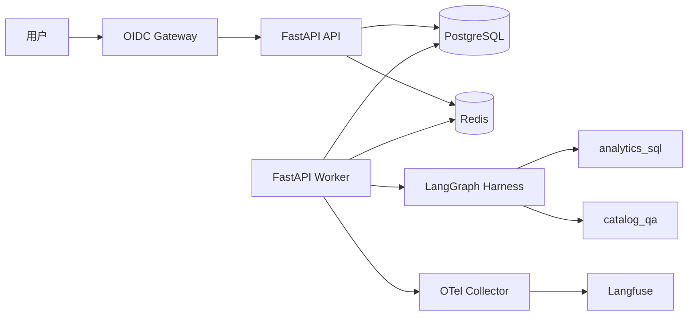

# 00 - 电商问数：前言与学习路径

---

**本章目标：**

- 理解项目从单条 LangGraph 问数链路演进为多 Agent Harness 的原因。
- 建立 API、Worker、Agent、PostgreSQL、Redis、HITL 和可观测性的整体认知。
- 了解教程的阅读顺序、源码边界和验证方式。

**学习建议：** 先读本篇和 02 章，建立“请求入队、Worker 执行、状态持久化、事件流返回”的主线。不要一开始陷入每个类的实现细节，后续章节会沿同一条请求链路逐层展开。

**适用源码：** `data_chat_agent/app`

**源码入口：** `main.py`、`app/worker_main.py`、`app/application.py`

---

## 1、这个项目解决什么问题

「电商问数」仍然解决企业分析中的典型问题：业务用户不会写 SQL，但希望用自然语言查询订单、商品、客户、地区和指标数据。

系统先构建元数据知识库，再让 Agent 联合使用字段向量、指标向量、字段取值全文索引和 MySQL 数仓，完成：

```text
自然语言问题
  -> Agent 选择
  -> 多轮问题解析
  -> 字段 / 指标 / 字段值召回
  -> SQL 上下文构建
  -> 只读 SQL 生成与安全校验
  -> 条件 HITL 审批
  -> 数仓执行
  -> SSE 流式返回
```

与教学版单图相比，当前项目把运行时可靠性、身份、安全、审批和观测从业务图中独立出来，形成 Harness。

## 2、为什么需要 Harness

只在 FastAPI 请求内直接执行一张图，会碰到以下生产问题：

- HTTP 断线后运行无法恢复。
- 多实例部署时没有共享 Checkpoint 和事件流。
- 人工审批需要跨请求暂停和恢复。
- Agent 选择、Prompt 版本和运行预算无法审计。
- SQL 生成结果可能越权、误写或扫描过多数据。
- 日志、指标和跨进程 trace 无法串联。

当前 Harness 把这些能力放到业务 Graph 外层：



## 3、首版两个 Agent

| Agent | 职责 | 不应做什么 |
| --- | --- | --- |
| `analytics_sql` | 查询真实数据、生成和校验只读 SQL、审批后执行 | 不回答脱离目录的字段定义 |
| `catalog_qa` | 解释表、字段、指标定义和口径 | 不执行 SQL、不访问真实业务数据值 |

两个 Agent 使用同一层会话、运行、审批、预算、事件和观测能力，但状态、Prompt 和工具白名单相互独立。

## 4、项目最终形态

- `FastAPI API`：提供会话、运行、SSE、取消和人工任务接口。
- `FastAPI Worker`：异步领取持久任务并执行 LangGraph。
- `PostgreSQL`：保存会话、运行、事件、队列、审批和 Checkpoint。
- `Redis`：保存可重建的会话快照、事件流、限流状态和 Worker 唤醒信号。
- `MySQL/Qdrant/Elasticsearch/TEI`：保留原有数据、检索和 Embedding 能力。
- `OpenTelemetry + Langfuse`：记录跨 API 与 Worker 的 trace、指标和模型调用。

## 5、学习路线

**第一阶段：业务与数据基础（00–09）**

理解数仓、配置、现有数据访问层和元数据知识库。这些部分虽不是 Harness 本身，但决定了 Agent 能使用怎样的业务上下文。

**第二阶段：Agent 与 Harness（10–21）**

掌握 LangGraph Checkpoint/Interrupt、Agent 注册表、Router、两个子图、PostgreSQL 队列、Redis 热缓存、SSE 和 Worker。

**第三阶段：生产治理（22–27）**

学习 OIDC、SQL 安全、预算、限流、审计、数据保留、可观测性、测试和生产 Compose。

**第四阶段：维护与扩展（28）**

按源码地图定位模块，并按既定契约增加新 Agent 或工具。

## 6、阅读代码时先看什么

1. 先看 `app/harness/graph.py` 的外层图结构。
2. 再看 `app/agents/analytics_sql/graph.py` 和 `app/agents/catalog_qa/graph.py`。
3. 然后进入 `app/harness/worker.py`，理解图如何被持久任务调度。
4. 最后看 Store、Redis、API 和前端，形成闭环。

本项目 `app` 下所有非空 Python 代码行都带中文说明。文档中的代码片段只挑关键行，完整代码以该注释版本为准。

## 7、项目边界

- 首版是单租户组织模型，`tenant_id` 用于身份、配额、会话和审计隔离，不自动改写业务 SQL。
- 数据仓库当前复用已有 MySQL 账号；应用层执行严格只读防护，生产仍建议切换只读账号。
- 首版不加载远程 Agent 插件，不通过 HTTP 注册可执行代码。
- 本地开发环境未提供 Docker 时，容器、真实 PostgreSQL 和真实模型验收必须明确标记未执行。

## 8、验证方式

章节中出现的命令均以项目根目录为起点：

```bash
uv sync --all-groups
uv run pytest tests/unit -q
uv run ruff check app main.py migrations tests evals scripts
```

前端位于 `frontend/`：

```bash
pnpm lint
pnpm test
pnpm build
```

---

**本章小结：**

本项目不是把更多 Prompt 塞进一张图，而是把 Agent 的业务能力、运行生命周期、人工控制和生产治理分层。后续章节会围绕一次真实运行，从请求入队追到 PostgreSQL Checkpoint、Worker、Agent、审批、SQL 和最终 SSE。

[文档导航](README.md) | [下一章：项目概述与数仓基础](01-项目概述与数仓基础.md)
