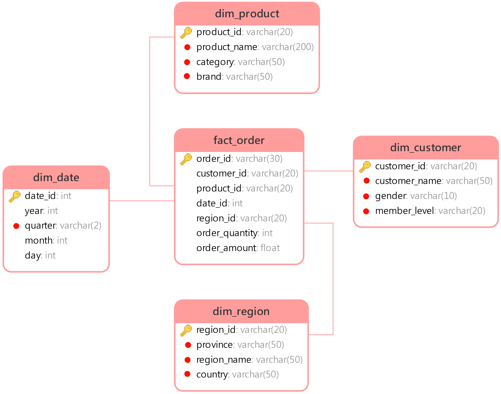

# 01 - 电商问数：项目概述与数仓基础

---

**本章目标：**

- 理解 NL2SQL、数据仓库和维度建模的基本概念。
- 看懂当前教学数仓的事实表、维度表和指标关系。
- 明确 Harness 不替代数仓，而是治理“谁能如何查询数仓”。

**学习建议：** 先理解事实表与维度表，再看 SQL 生成章节。Agent 能否稳定生成 SQL，很大程度取决于目录、指标口径和表关系是否清楚。

**对应源码与配置：** `docker/mysql/dw.sql`、`conf/meta_config.yaml`

---

## 1、项目定位

业务数据库服务在线事务，数据仓库服务分析查询。问数 Agent 不应直接面对业务库，而应面对经过治理的分析数据层。

本项目保留一套电商教学数仓：

| 表 | 类型 | 作用 |
| --- | --- | --- |
| `fact_order` | 事实表 | 保存订单粒度数量和金额 |
| `dim_region` | 维度表 | 地区、省份和大区 |
| `dim_customer` | 维度表 | 客户属性与会员等级 |
| `dim_product` | 维度表 | 商品、品牌和品类 |
| `dim_date` | 维度表 | 年、季度、月、日 |

## 2、OLTP、OLAP 与问数

- `OLTP` 强调高并发、单行读写和事务一致性。
- `OLAP` 强调扫描、聚合、分组和多表关联。
- 问数 Agent 的主要读路径属于分析型查询。

问数系统通常还要访问三类存储：

1. MySQL：权威结构化数据和教学数仓。
2. Qdrant：字段和指标的语义向量。
3. Elasticsearch：字段真实取值的全文索引。

## 3、事实表与维度表

事实表保存业务事件和度量，维度表描述分析角度。



以“统计 2025 年第一季度各大区的 GMV”为例：

- 金额来自 `fact_order.order_amount`。
- 季度来自 `dim_date.quarter`。
- 大区来自 `dim_region.region_name`。
- 表关系依赖 `date_id` 和 `region_id`。

字段召回只找到列还不够，后续还要补齐主外键，才能构造正确的 JOIN。

## 4、指标口径为什么单独建模

指标不是简单字段别名。例如 `GMV` 可能包含：

- 指标名称和同义表达。
- 依赖字段。
- 业务过滤条件。
- 时间口径。

当前配置把指标保存为 `MetricInfo`，并将依赖字段保存到 `column_metric` 关系。

```yaml
metrics:
  - name: GMV
    description: 所有订单的成交金额总和。
    relevant_columns:
      - fact_order.order_amount
    alias: [成交总额, 订单总额]
```

Harness 的 SQL 生成节点只把当前问题相关的指标上下文交给模型，减少模型自行猜测口径。

## 5、从数据到可执行查询


执行层 `app/tools/sql_execution.py` 会再次解析 SQL、设置执行时限并限制结果规模。它不会信任模型输出。

## 6、数据资产边界

以下文件属于基准数据，不应在普通开发中被脚本自动改写：

- `docker/mysql/meta.sql`
- `docker/mysql/dw.sql`
- `docker/elasticsearch/plugins/` 下的插件包
- `docker/embedding/` 下的模型文件

本教程更新只修改 Markdown；其他任务修改这些资产时必须明确说明迁移和回滚方式。

## 7、常见误区

### 7.1 “SQL 语法正确就代表结果正确”

语法正确只能说明数据库能解析。字段值、时间范围、JOIN 路径和指标口径仍可能错误。

### 7.2 “字段召回能替代指标”

字段只描述“查哪一列”，指标还要描述“怎么算”和“按什么条件算”。

### 7.3 “所有表都交给 LLM 更安全”

上下文越大不等于越准确。召回、合并和过滤的目标是把候选缩小到相关且足够的范围。

---

**本章小结：**

数仓提供事实、维度和指标数据；元数据知识库把结构变成可检索上下文；Harness 负责选择 Agent、构造安全边界并持久化运行。下一章从整体架构看这些部分如何协作。

[上一章：前言与学习路径](00-前言与学习路径.md) | [文档导航](README.md) | [下一章：Harness 总体架构](02-Harness总体架构与请求生命周期.md)
