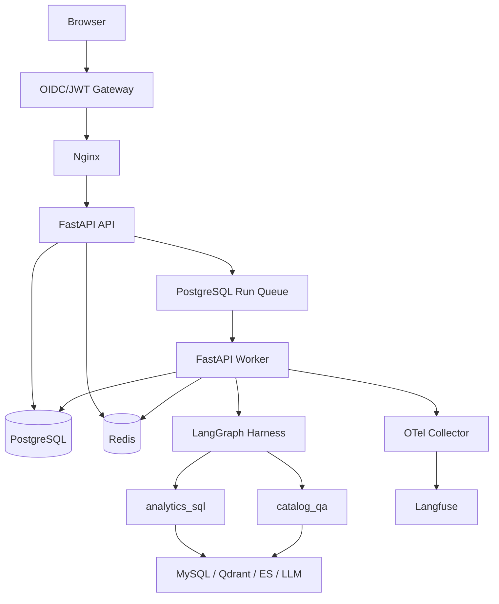
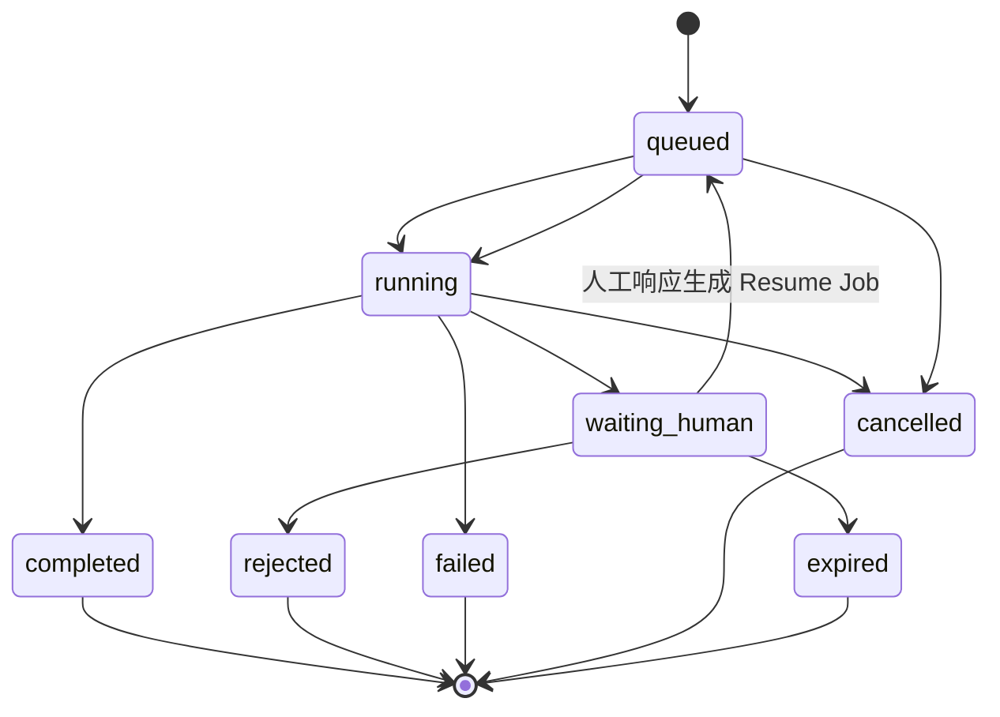

# 02 - Harness 总体架构与请求生命周期

---

**本章目标：**

- 理解 API 与 Worker 分离的原因。
- 掌握一次运行从入队到终态的完整顺序。
- 分清 PostgreSQL、Redis 和业务数据服务的职责。

**学习建议：** 先看图中的箭头，再看每个状态由谁写入。任何“在请求协程里直接跑完整 Agent”的简化都与当前实现不一致。

**对应源码：** `app/api/`、`app/application.py`、`app/harness/worker.py`

---

## 1、整体架构



这个结构有三个关键分离：

1. **HTTP 与执行分离**：API 只做身份、校验和入队。
2. **业务状态与运行时依赖分离**：State/Checkpoint 持久化，连接对象只存在于当前进程。
3. **权威存储与热层分离**：PostgreSQL 决定真相，Redis 可丢可重建。

## 2、API 请求阶段

创建运行的主要步骤：

1. JWT 校验并得到 `user_id`、`tenant_id`、`roles`。
2. 校验 Query 长度、Agent ID 和 `Idempotency-Key`。
3. Redis 执行分钟级限流。
4. PostgreSQL 检查会话、单活运行、用户/租户并发和队列容量。
5. 写入 `runs`、`run_jobs` 和用户消息。
6. 写入 `run.queued` 事件并唤醒 Worker。
7. 返回 `202 + run_id`。

API 不持有 Agent 的长时间连接，因此客户端可以离开后再从 SSE 续传。

## 3、Worker 执行阶段

Worker 使用 `FOR UPDATE SKIP LOCKED` 领取任务：

- 设置 `lease_owner` 和 `lease_until`。
- 每 20 秒续租。
- 崩溃后租约过期，其他 Worker 可以回收。
- 成功后任务完成，失败时按可重试性决定再次入队或结束。

Worker 执行时从 Checkpointer 恢复或创建运行，随后执行外层 Harness Graph。

## 4、运行状态机



终态不会因重复 Resume 或重复 Worker 消息而回退。Store 在事务中同时校验运行状态、人工任务版本和唯一约束。

## 5、事件流

节点通过 `runtime.stream_writer` 写出进度。Worker 将事件先写 PostgreSQL，再发布 Redis Stream：

```text
LangGraph custom event
  -> app/harness/events.py
  -> PostgreSQL run_events（权威回放）
  -> Redis Stream（低延迟）
  -> FastAPI SSE
  -> Browser
```

Redis 不可用时，SSE 读取 PostgreSQL；因此事件流不是“Redis 独占”，缓存丢失不会让运行结果不可见。

## 6、存储职责

| 存储 | 权威数据 | 可丢失数据 |
| --- | --- | --- |
| PostgreSQL | Session、Run、Job、Event、Intervention、Audit、Checkpoint | 否 |
| Redis | 会话快照、事件副本、限流状态、唤醒信号 | 是 |
| MySQL Meta | 表、字段、指标、关系 | 否，属于业务目录 |
| MySQL DW | 教学事实数据 | 否，属于查询对象 |
| Qdrant | 字段和指标向量 | 可重建索引 |
| Elasticsearch | 字段值全文索引 | 可重建索引 |

## 7、跨进程 Trace

API 创建运行时捕获 W3C `traceparent` 并写入 Run/Job。Worker 恢复这个上下文，因此 Router、子图节点、SQL 工具和审批后的继续执行可以关联到同一运行 trace。

模型 Prompt 和响应默认经过脱敏后进入 Langfuse；通用 OTel Collector 只接收手工 span 和自动仪器化数据。

## 8、异常边界

- 预料内业务错误：转成稳定 `AppError.code` 和 SSE 失败事件。
- 可重试依赖错误：任务重新排队，运行保持可恢复状态。
- Agent checkpoint 与当前版本不兼容：明确失败，不使用错误图继续。
- Redis 不可用：已接受运行继续；新运行因无法严格限流而返回 503。
- PostgreSQL 不可用：运行暂停，不能由 Redis 单独恢复。

## 9、一次真实示例

用户问：“统计 2025 年第一季度各大区的 GMV”。

1. Router 根据“统计”和“GMV”选择 `analytics_sql`。
2. Query Planner 将问题生成独立查询和三类检索词。
3. 三路召回并行。
4. Merge 补主外键和值示例。
5. 表/指标过滤生成精简上下文。
6. SQL 生成后通过 AST Guard 和 EXPLAIN。
7. 普通只读 SQL 自动执行；校正后或高风险 SQL 进入审批。
8. Worker 返回结果，前端展示表格、SQL 和执行轨迹。

---

**本章小结：**

Harness 的核心不是新增几个类，而是明确“HTTP 请求只入队、Worker 执行、PostgreSQL 记真相、Redis 提供热路径、LangGraph 负责 Agent 业务图、HITL 暂停而不占 Worker”。后续章节会分别展开这些边界。

[上一章：项目概述与数仓基础](01-项目概述与数仓基础.md) | [文档导航](README.md) | [下一章：开发环境与生产依赖](03-开发环境与生产依赖准备.md)
