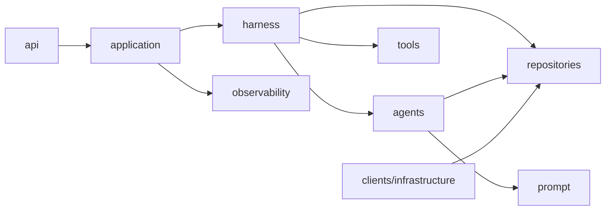

# 04 - 项目结构、配置与异步基础设施

---

**本章目标：**

- 看懂重构后的 `app` 目录和模块边界。
- 理解 Pydantic Settings、错误模型、上下文变量与结构化日志。
- 掌握“短 Session、长进程、无全局请求状态”的异步原则。

**学习建议：** 本章是整个源码的导航层。先分清 API、Harness、Agent、Tools、Repositories 和 Observability，再进入具体业务。

**对应源码：** `app/conf/settings.py`、`app/core/`、`app/application.py`

---

## 1、目录结构

```text
app/
├── agent/                 旧问数节点与 State（逐步收敛为子图业务模块）
├── agents/                注册表、analytics_sql、catalog_qa
├── api/                   FastAPI 应用、v1 路由和 Pydantic 契约
├── auth/                  OIDC/JWT 校验
├── clients/               MySQL/Qdrant/ES/Embedding 客户端生命周期
├── conf/                  YAML 配置与 Pydantic Settings
├── core/                  错误、日志和 ContextVar
├── entities/              业务实体
├── harness/               运行、队列、Checkpoint、Router、事件、Worker
├── infrastructure/        模型运行时
├── models/                元数据 ORM
├── observability/         OTel、Langfuse、日志和 Node span
├── prompt/                受限 Prompt 加载
├── repositories/          MySQL/Qdrant/ES 数据访问
├── scripts/               元数据构建与数据库迁移
├── services/              元数据知识库构建服务
├── tools/                 SQL Guard、执行工具和输入契约
└── worker_main.py         Worker 进程入口
```

## 2、依赖方向



原则：

- API 不直接创建数据库 Session 或执行 Graph。
- Agent 节点通过 Context 使用工具，不持有全局连接。
- Repository 不决定审批策略。
- Tools 只做确定性的校验和执行。
- Harness 决定生命周期，不替 Agent 解释业务。

## 3、两组配置

项目保留两类配置：

**业务目录配置**

- `conf/meta_config.yaml`
- 描述表、字段、指标和别名。

**运行与安全配置**

- `app/conf/settings.py`
- 使用 `pydantic-settings` 从环境变量加载 PostgreSQL、Redis、OIDC、预算、限流、保留期和观测设置。

```python
class Settings(BaseSettings):
    environment: Literal["development", "test", "staging", "production"]
    postgres_dsn: str
    redis_url: str
    run_max_llm_calls: int = 10
    run_max_tokens: int = 64_000
```

`APP_ENV=production` 时，配置校验要求完整 OIDC fixture，并禁止开发免鉴权。

## 4、为什么不能把连接放进 State

LangGraph State 会被序列化写入 Checkpoint。数据库连接、HTTP 客户端、Semaphore 都不可序列化，也不应该被恢复。

正确划分：

```text
State   -> query、SQL、召回结果、审批、预算等业务数据
Context -> Repository、LLM、Semaphore、Telemetry、Run 元数据
```

## 5、错误模型

`app/core/errors.py` 定义稳定错误语义：

- 业务错误映射为 Problem Details。
- 可重试依赖错误带 `retryable=True`。
- 内部异常不把堆栈、SQL 或密钥返回前端。

```json
{
  "title": "Budget Exceeded",
  "status": 409,
  "detail": "run budget exceeded: tokens",
  "code": "BUDGET_EXCEEDED",
  "request_id": "...",
  "trace_id": "..."
}
```

## 6、ContextVar 与结构化日志

HTTP 请求、运行和 trace 都有独立关联 ID：

- `request_id_ctx_var`
- `run_id_ctx_var`
- OTel current span trace ID

日志通过 Loguru JSON sink 输出到 stdout。容器环境不写本地文件，由平台统一收集。

日志不记录完整问题、SQL 原文、JWT、Secret 或查询结果。

## 7、异步原则

### 7.1 不在协程中执行阻塞调用

文件 Prompt 在启动时加载并缓存；Jieba 冷启动和少量 CPU 工作通过线程或启动预热规避事件循环阻塞。

### 7.2 不跨协程共享 Session

Meta MySQL 和 DW MySQL 使用 `ScopedRepository`：

```text
节点调用仓储方法
  -> 获取一个 AsyncSession
  -> 执行一次读写
  -> 归还会话到连接池
```

这样 LLM/Qdrant 长调用不会占住 MySQL 连接。

### 7.3 所有外部调用都有上限

- LLM：Semaphore + timeout + token/call budget。
- 检索：每分支和全局 Semaphore。
- SQL：数据库和 Python 双重 timeout。
- Worker：有限并发、任务 attempt 上限、租约心跳。

## 8、逐行注释约定

`app` 下每个非空代码行都有中文说明：

- import：说明导入能力。
- 声明：说明类/函数/参数职责。
- 调用：说明调用对象和结果去向。
- 多行集合：逐项说明配置或数据。
- 收尾括号：说明结束的结构。

空白行、docstring 和字符串正文不加代码注释，避免改变 `__doc__` 或字符串值。`tests/unit/test_app_source_comments.py` 会验证源码覆盖。

## 9、配置修改流程

1. 在 `Settings` 增加字段与默认值。
2. 在 `.env.example` 增加无密钥占位说明。
3. 生产 Compose 只传配置名，不写实际 Secret。
4. 更新启动校验和运行文档。
5. 加配置单元测试，覆盖开发/生产差异。

## 10、常见误区

- 在节点 import 时创建 Engine 或读取 Secret。
- 将 FastAPI `Request` 或数据库 Session 塞进 Checkpoint。
- 用普通全局变量保存 request/run 上下文。
- 为每个请求重新初始化 LLM、Qdrant 或连接池。
- 为通过 lint 删除逐行说明，而不是为受注释 import 设置局部规则。

---

**本章小结：**

Harness 的底层稳定性来自明确分层：配置只描述行为边界，Context 承载不可序列化依赖，State 只保存业务数据，Repository 负责数据访问，工具保持确定性，日志和 trace ID 贯穿并发链路。

[上一章：开发环境与生产依赖](03-开发环境与生产依赖准备.md) | [文档导航](README.md) | [下一章：Qdrant 与 Elasticsearch](05-Qdrant与Elasticsearch接入.md)
