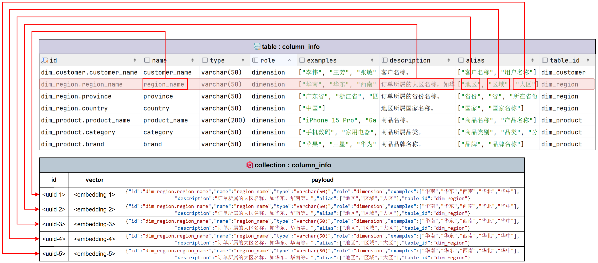
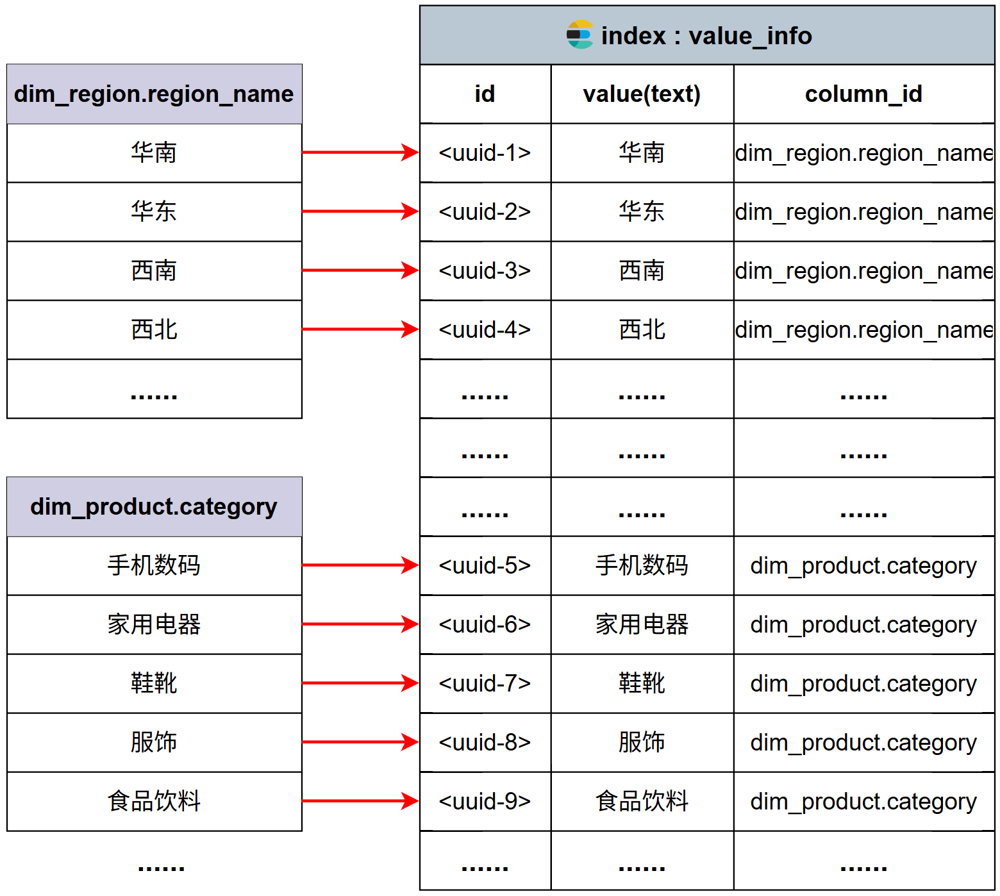

# 05 - 电商问数：Qdrant 与 Elasticsearch 接入

---

**本章目标：**

- 区分语义向量检索与全文检索的职责。
- 掌握 Collection、Point、Vector、Payload、Index、Document、Mapping。
- 看懂 Qdrant/ES 客户端与仓储层的异步访问边界。

**前置知识：** Python 异步、JSON、基础数据库概念。

**对应源码：**

- `app/clients/qdrant_client_manager.py`
- `app/clients/es_client_manager.py`
- `app/repositories/qdrant/`
- `app/repositories/es/value_es_repository.py`

---

## 1、为什么需要两类检索

用户问“统计华北地区的销售总额”时，包含三种语义：

- “销售总额”更接近字段或指标语义。
- “华北”更可能是字段真实取值。
- “统计”表达聚合意图。

Qdrant 擅长回答“语义上像哪个字段/指标”，Elasticsearch 擅长回答“文本是否命中真实字段值”。

| 系统 | 当前用途 | 不适合承担的职责 |
| --- | --- | --- |
| Qdrant | 字段和指标向量召回 | 保存权威元数据、判断真实值 |
| Elasticsearch | 字段真实取值全文检索 | 保存完整指标口径、执行 SQL |

## 2、Qdrant 核心概念

- `collection`：维度一致、距离度量一致的向量点集合。
- `point`：一条向量记录，由 id、vector、payload 组成。
- `payload`：字段实体序列化后的业务数据。
- `distance`：当前使用余弦距离 `COSINE`。

字段可能按名称、描述、每个别名拆成多个 point。多个 point 的 payload 指向同一业务字段，因此召回后必须按 `ColumnInfo.id` 去重。



## 3、当前 Collection

| Agent 用途 | Collection | 说明 |
| --- | --- | --- |
| 字段语义召回 | `column_info_collection` | 字段名、描述、别名 |
| 指标语义召回 | `metric_info_collection` | 指标名、描述、别名 |

`ensure_collection()` 只在集合不存在时创建，向量维度来自 `app_config.qdrant.embedding_size`。

## 4、Qdrant 客户端生命周期

`QdrantClientManager` 在应用启动时创建 `AsyncQdrantClient`，在关闭阶段释放。节点不自行 new 客户端，避免每请求建立连接池。

```text
ApplicationContainer.start
  -> qdrant_client_manager.init()
  -> Repository 共享 client
ApplicationContainer.close
  -> qdrant_client_manager.close()
```

`upsert()` 按 batch 写入，降低单次网络请求压力。字段和指标仓储只负责稳定读写，不决定“一个字段应该生成哪些语义入口”。

## 5、Elasticsearch 核心概念

- `index`：同类文档集合。
- `document`：一条 JSON 数据。
- `mapping`：字段类型、分词器和索引方式。
- `keyword`：完整值匹配，不分词。
- `text`：全文分词匹配。

字段值索引的文档结构：

```json
{
  "id": "dim_region.region_name.华北",
  "value": "华北",
  "column_id": "dim_region.region_name"
}
```

`value` 使用 IK 分词，`id` 和 `column_id` 使用 keyword，便于稳定标识和过滤。



## 6、仓储接口

字段值仓储的方法边界：

- `ensure_index()`：确保索引和 mapping 存在。
- `index(value_infos)`：按 batch bulk 写入。
- `search(keyword, limit)`：最小分数和数量受控。

仓储不接收 LLM 生成的任意查询 DSL。检索参数由 Agent 流程和配置决定，避免把全文检索变成未治理的查询执行入口。

## 7、并发与超时

Worker 同时执行多路检索，因此：

- Embedding、Qdrant、ES 调用有全局 Semaphore。
- 每个召回分支还有局部并发上限。
- 单个搜索有 `tool_timeout_seconds`。
- 异常不会被转换为空列表，否则可能把依赖失败伪装成“没有召回结果”。

## 8、验证

```bash
uv run pytest tests/unit/test_harness_graph.py -q
uv run pytest tests/unit -q
```

手动验证时在 Qdrant 查看 collection，在 Kibana 查看 `value_index`，重点是：

- 字段 point 的 payload 是否指向正确 `column_info.id`。
- 字段值文档是否带正确 `column_id`。
- 同一业务字段的多 point 是否在 Agent 召回后按实体 id 去重。

## 9、注意事项

- 不要让模型直接构造 Qdrant filter 或任意 ES DSL。
- 不要在每次检索时创建新客户端。
- 不要让 payload 中的敏感样例未经治理进入 `catalog_qa`。
- 索引是派生数据，可以重建，但不能代替 MySQL 权威元数据。

---

**本章小结：**

Qdrant 和 ES 都提供检索，但结构化权威信息仍在 MySQL。仓储层负责可重复的存储操作，Agent 节点负责召回策略，Harness 负责并发、超时和失败控制。

[上一章：项目结构与配置](04-项目结构、配置与异步基础设施.md) | [文档导航](README.md) | [下一章：MySQL、Embedding 与仓储](06-MySQL、Embedding与仓储基础.md)
