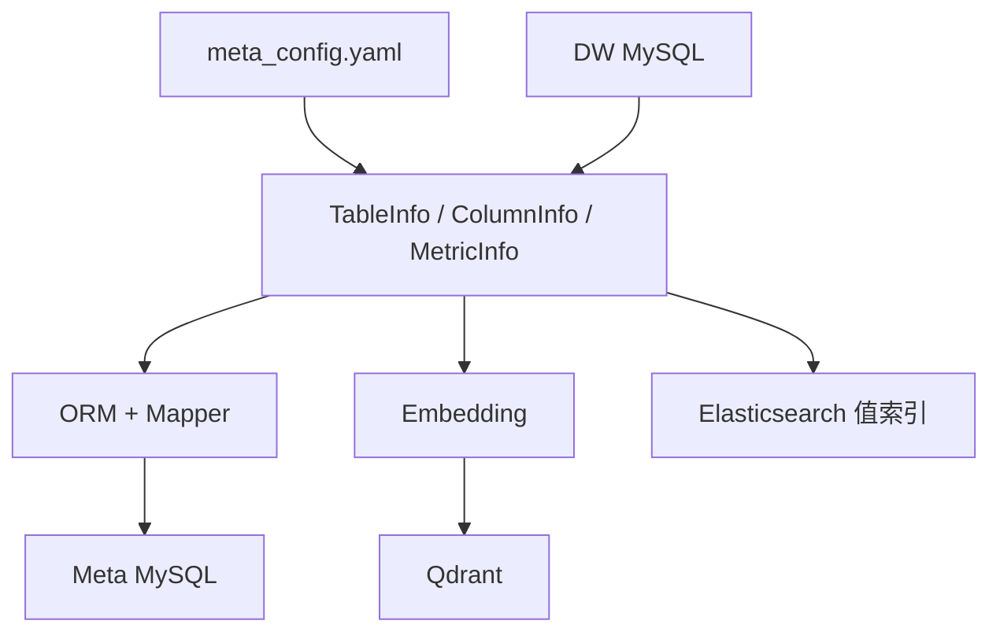
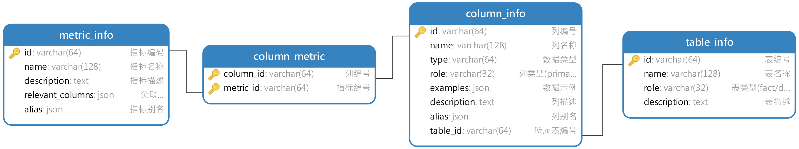

# 07 - 电商问数：元数据知识库总览与构建入口

---

**本章目标：**

- 理解配置文件、业务实体、ORM 模型和 Mapper 四种角色。
- 掌握元数据同步脚本的调用链。
- 理解配置路径必须限制在项目目录内的原因。

**对应源码：**

- `app/scripts/build_meta_knowledge.py`
- `app/services/meta_knowledge_service.py`
- `app/conf/meta_config.py`
- `app/entities/`、`app/models/`

---

## 1、知识库包含什么



元数据知识库不是单一数据库，而是结构化目录、向量索引和全文索引的组合。

## 2、四类角色

| 角色 | 回答的问题 | 当前目录 |
| --- | --- | --- |
| 配置文件 | 本次同步哪些表和指标 | `conf/meta_config.yaml` |
| 业务实体 | 系统内部如何统一表达 | `app/entities/` |
| ORM 模型 | Python 类如何映射数据库表 | `app/models/` |
| Mapper | 实体与 ORM 如何互换 | `app/repositories/mysql/meta/mappers/` |

配置文件不是数据库记录，业务实体也不是 ORM 模型。每层只承担自己的转换职责。

## 3、配置驱动

同步脚本不扫描整个数仓，而是只处理配置声明的范围：

```yaml
tables:
  - name: fact_order
    role: fact
    description: 订单事实表
    columns:
      - name: order_amount
        role: measure
        description: 订单金额
        alias: [销售额, 成交金额]
        sync: false
```

好处：

- 只暴露被治理的表和字段。
- 明确指标口径和别名。
- 用 `sync` 控制哪些真实字段值进入全文索引。

## 4、构建入口

```bash
uv run python -m app.scripts.build_meta_knowledge \
  -c conf/meta_config.yaml
```

入口脚本负责：

1. 解析命令行参数。
2. 初始化 MySQL、Qdrant、Embedding 和 ES 客户端。
3. 创建 Repository 和 `MetaKnowledgeService`。
4. 调用 `build(config_path)`。
5. 在 finally 中关闭资源。

入口不直接承载业务细节。

## 5、路径安全

`MetaKnowledgeService.build()` 会执行：

```python
resolved_path = config_path.resolve()
if not resolved_path.is_relative_to(PROJECT_ROOT):
    raise ValueError("meta config path must stay inside the project")
```

原因：

- 本地任务禁止读取项目目录外文件。
- 避免通过命令行参数让脚本访问任意配置。
- 保证容器内路径与工程结构一致。

符号链接和 `..` 都会在 `resolve()` 后检查。

## 6、同步顺序

```text
读取配置
  -> 表/字段 -> Meta MySQL
  -> 字段语义 -> Qdrant
  -> 配置允许的字段值 -> Elasticsearch
  -> 指标和字段关系 -> Meta MySQL
  -> 指标语义 -> Qdrant
```

如果只改指标描述，可重新写入同一 collection；如果改模型维度或索引结构，要制定重建计划。

## 7、幂等性与覆盖

ES 文档以稳定 id upsert；Qdrant 使用随机 point id，多次执行可能产生重复点。生产重建应先构建新 collection、校验后切换 alias，而不是无计划地覆盖在线集合。

MySQL 元数据是否覆盖取决于主键与 ORM 行为。修改同步策略前必须先确认是否允许更新既有行。

## 8、验证

同步完成后分别检查：

- MySQL：表、字段、指标和关系表。
- Qdrant：字段、指标 collection 和 payload。
- Elasticsearch：`value_index` mapping 与文档。
- 字段 `examples` 是否只来自允许同步的样例。



## 9、注意事项

- 配置文件是业务输入，不是密钥容器。
- 字段类型和样例值由 DW 补齐，不重复写在配置。
- Mapper 只转换对象，不承担业务规则。
- 不在入口脚本中堆积事务和检索逻辑。
- 不删除模型文件和数据库初始化资产。

---

**本章小结：**

元数据构建采用配置驱动和分层转换。Service 编排同步流程，Repository 负责存储细节，Mapper 在业务实体与 ORM 之间转换，路径校验把文件访问限制在当前项目内。

[上一章：MySQL、Embedding 与仓储](06-MySQL、Embedding与仓储基础.md) | [文档导航](README.md) | [下一章：表与字段元数据同步](08-表与字段元数据同步.md)
