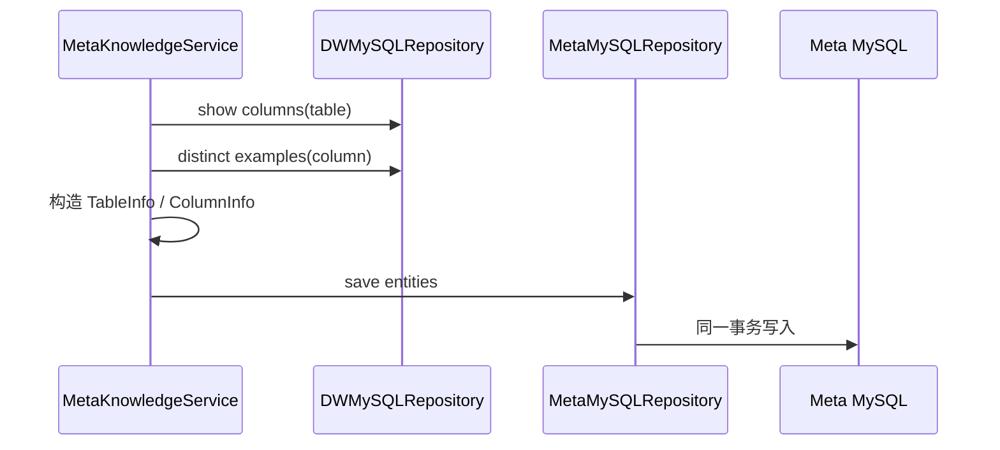
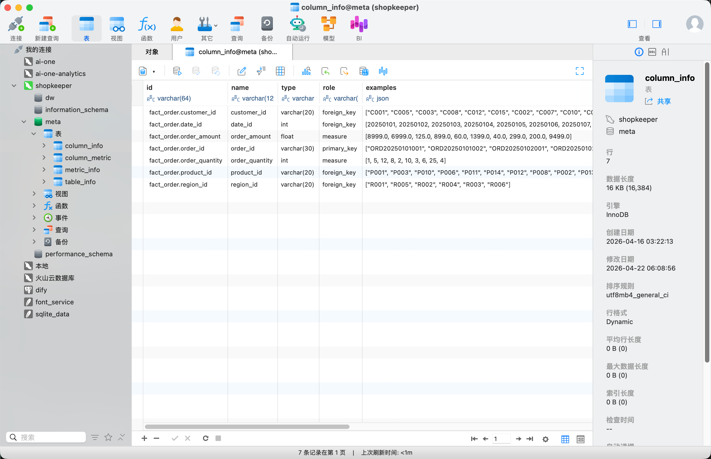

# 08 - 电商问数：表与字段元数据同步

---

**本章目标：**

- 理解“配置 → DW 补齐 → 业务实体 → 事务落库”链路。
- 掌握字段稳定 ID、真实类型和示例值来源。
- 识别批量同步中的事务与依赖问题。

**对应源码：** `app/services/meta_knowledge_service.py`、`app/repositories/mysql/dw/`、`app/repositories/mysql/meta/`

---

## 1、主流程



Service 先整理业务实体，Repository 再通过 Mapper 转换成 ORM 模型。

## 2、稳定字段 ID

字段 ID 采用：

```text
table_name.column_name
```

例如 `fact_order.order_amount`。仅使用字段名会与多张表里的 `id`、`customer_id` 等冲突。

稳定 ID 的意义：

- Qdrant payload 可追踪回字段。
- ES 值文档可以关联字段。
- 指标 `relevant_columns` 可以精确引用字段。
- 审批与审计可以使用稳定标识。

## 3、从 DW 补齐真实信息

配置只维护业务语义，字段类型和示例值从 DW 查询。

`DWMySQLRepository.get_column_types()`：

- 按表一次读取全部列类型。
- 表名先经过标识符正则校验。

`get_column_values()`：

- 按列抽样去重值。
- limit 被限制在安全范围。
- 这些值只用于元数据示例，不等于完整值索引。

## 4、实体构造

每个 `ColumnInfo` 聚合：

- 稳定 ID
- 名称、类型、角色
- 示例
- 描述、别名
- 所属表

不要在 Service 中直接创建 `ColumnInfoMySQL`。领域实体仍可继续用于 Qdrant 和 ES 构建。

## 5、事务边界

表和字段应在同一事务中写入：

```python
async with repository.session.begin():
    repository.save_table_infos(tables)
    repository.save_column_infos(columns)
```

原因：

- 字段不能引用不存在的表。
- 只成功一半会污染后续召回。
- 回滚应覆盖整个结构同步单元。

## 6、失败模式

| 失败 | 结果 |
| --- | --- |
| 配置字段不在 DW | 类型查询 KeyError/明确异常，事务不开始 |
| DW 暂不可用 | 同步失败，不写部分数据 |
| Meta 约束冲突 | 事务回滚 |
| 示例值为空 | 字段可入库，examples 为空列表 |
| 配置路径越界 | 在读取前拒绝 |

## 7、验证

```bash
uv run python -m app.scripts.build_meta_knowledge \
  -c conf/meta_config.yaml
```

检查：

1. `table_info.id` 与配置名称一致。
2. `column_info.id` 为 `表名.字段名`。
3. `type` 与 DW 真实类型一致。
4. `examples` 来自允许的抽样查询。
5. `description`、`alias`、`table_id` 与配置一致。



## 8、注意事项

- `session.add_all()` 不是提交。
- 表名和列名不接受任意字符串插值。
- 不在循环中共享一个已经关闭的 Session。
- 不把元数据示例值当成完整数据分布。
- 不把 ORM 对象传给 LLM。

---

**本章小结：**

表字段同步把外部配置与 DW 真实结构合并成稳定业务实体，再由 Repository 和 Mapper 写入 Meta MySQL。事务边界与标识符校验是这条链路的核心安全点。

[上一章：元数据知识库](07-元数据知识库总览与构建入口.md) | [文档导航](README.md) | [下一章：字段、指标与值索引](09-字段、指标与值索引构建.md)
