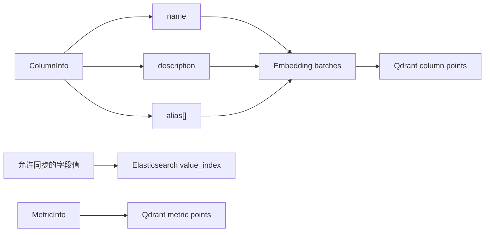
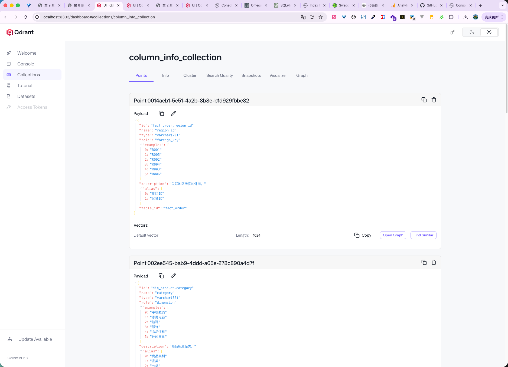
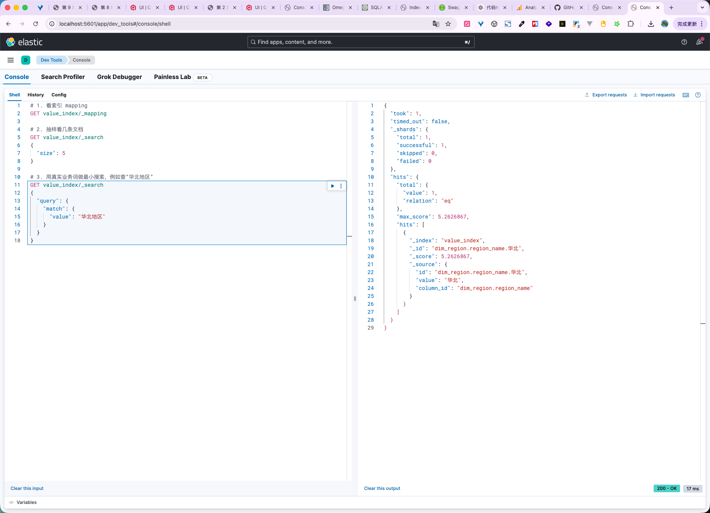

# 09 - 电商问数：字段、指标与值索引构建

---

**本章目标：**

- 理解一个字段为什么要拆成多个向量语义入口。
- 掌握字段值全文索引和指标向量索引的构建过程。
- 识别批量、分页、去重和索引重建风险。

**对应源码：** `app/services/meta_knowledge_service.py`、`app/repositories/qdrant/`、`app/repositories/es/`

---

## 1、索引构建总图



## 2、字段向量入口

同一字段创建多类文本：

```text
order_amount
订单金额
销售额
成交金额
```

每个文本生成独立 point，共享同一 `ColumnInfo` payload。这样用户使用名称、解释或别名都可能召回字段。

## 3、批处理

Embedding 和 upsert 都分批：

- `aembed_documents()` 每次处理一小组文本。
- 返回向量顺序必须与输入文本一致。
- `PointStruct(id, vector, payload)` 三列按相同下标组合。

批次大小是吞吐与单次内存的折中。不能把整库文本一次性发给 Embedding 服务。

## 4、字段值全文索引

只有配置中 `sync: true` 的字段才同步真实值。每个值构造：

```python
ValueInfo(
    id=f"{column_id}.{value}",
    value=value,
    column_id=column_id,
)
```

`value` 使用 IK 分词，`id` 与 `column_id` 使用 keyword。写入采用 bulk，操作行和数据行成对出现。

注意：真实值可能包含个人信息或商业敏感信息。`sync` 是数据治理开关，不是性能开关。

## 5、指标向量

指标从 name、description、alias 生成多个 point，并放入独立 `metric_info_collection`。

指标 payload 至少包含：

- 指标 ID
- 名称和描述
- 相关字段
- 别名

独立 collection 避免字段向量和指标向量在检索时混在一起。

## 6、幂等与重建

当前字段/指标 point 使用随机 UUID。重复构建可能增加重复点，召回节点按实体 ID 去重，但存储仍会增长。

生产重建建议：

1. 创建带版本后缀的新 collection。
2. 构建并验证召回质量。
3. 切换查询别名。
4. 保留旧索引一段时间后删除。

ES 文档使用稳定 id，重复 bulk 会覆盖同一文档。

## 7、失败模式

- Embedding 维度与 collection 不一致：写入失败。
- Qdrant/ES 短暂不可用：构建任务失败，不静默跳过。
- payload 无法 JSON 序列化：阻断写入。
- ES analyzer 未安装：创建 index 或检索失败。
- 上下文过长：调整批大小，不关闭超时。

## 8、验证





检查：

- 字段和指标 collection 维度正确。
- `ColumnInfo.id`、`MetricInfo.id` 在 payload 中稳定。
- ES 文档的 `column_id` 能回查 Meta MySQL。
- 用“华北”“黄金会员”“GMV”等词做最小检索验证。

## 9、注意事项

- 不把完整业务数据复制进 Qdrant payload。
- 不把所有字段值都同步到 ES。
- 不把别名扩展到无关概念。
- 不在召回后省略实体 ID 去重。
- 不更换模型后继续使用旧维度索引。

---

**本章小结：**

索引构建把权威元数据转换成多入口语义向量和受控字段值全文索引。向量库与全文索引都是派生层，必须可重建、可验证，并与 Meta MySQL 的稳定 ID 对齐。

[上一章：表与字段元数据同步](08-表与字段元数据同步.md) | [文档导航](README.md) | [下一章：LangGraph、Checkpoint 与中断恢复](10-LangGraph、Checkpoint与中断恢复基础.md)
