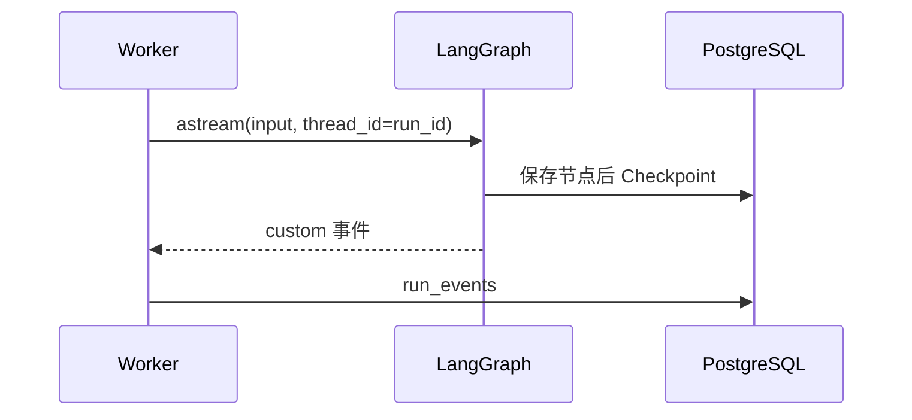

# 10 - LangGraph、Checkpoint 与中断恢复基础

---

**本章目标：**

- 掌握 StateGraph、State、Context、Node、Edge 与 Subgraph。
- 理解 Checkpoint 的权威存储和恢复含义。
- 掌握 `interrupt()` 与 `Command(resume=...)` 的基本机制。

**对应源码：** `app/harness/graph.py`、`app/harness/checkpoints.py`、`app/agents/*/graph.py`

---

## 1、LangGraph 在这套项目中的位置

Harness 不只是 LangGraph 的别名。Harness 负责运行、队列、身份、审批和观测；LangGraph 负责表达 Agent 内部的节点与分支。

```text
Harness Graph
  -> Agent 注册与路由
  -> analytics_sql / catalog_qa 子图
  -> Checkpoint 与 Interrupt
```

## 2、State 与 Context

State 会被 Checkpoint 序列化：

- 查询与 resolved query
- 召回实体
- SQL 和校验结果
- 预算、审批轮次和最终输出

Context 只在当前执行进程存在：

- Repository
- Embedding/Qdrant/ES 客户端
- Semaphore
- Telemetry
- Run/Identity 元数据

不要把连接对象放入 State。恢复运行时应用程序会重新构建 Context。

## 3、子图

两个 Agent 各自编译为独立子图：

- `analytics_sql`：复杂问数流程。
- `catalog_qa`：元数据检索和回答。

外层图只负责通用路由、人工确认和 Finalize，不读取子图内部未声明的状态。

## 4、Checkpoint

生产使用：

```python
AsyncPostgresSaver
```

PostgreSQL 是唯一权威 Checkpointer。Redis 中的会话快照不参与恢复判断。



每个运行使用独立 `thread_id=run_id`，避免同一会话前后运行共享 checkpoint 产生竞态。

## 5、Interrupt

需要人工输入时，节点调用：

```python
decision = interrupt(payload)
```

LangGraph 保存中断点并结束当前执行。Worker 创建 `HumanIntervention`，然后释放任务租约。

用户响应后，Worker 使用：

```python
Command(resume=decision)
```

从同一 `thread_id` 继续执行。

## 6、中断状态与运行状态

| LangGraph | Harness Run | 含义 |
| --- | --- | --- |
| 执行到 `interrupt()` | `waiting_human` | 等待人工任务 |
| Resume Job 写入 | `queued` | 等 Worker 领取 |
| Worker 恢复 | `running` | 继续图执行 |
| 子图结束 | `completed/rejected/failed` | 外层 Finalize 映射终态 |

人工等待不计入 180 秒有效执行预算，恢复时从预算快照继续。

## 7、版本兼容

Checkpoint 中固定：

- Agent ID
- Agent 版本
- State schema 版本
- Prompt 哈希

Worker 恢复前校验当前注册表。新版图无法兼容旧 checkpoint 时必须明确失败，不可用错误图“尝试恢复”。

## 8、常见问题

### 8.1 重复 Resume 会不会执行两次？

Store 对人工任务版本和 Resume Job 使用唯一约束；Worker 发现当前已无 interrupt 时继续执行 checkpoint，不再次消费同一决定。

### 8.2 为什么 Redis 清空后还能恢复？

Checkpoint 在 PostgreSQL。Redis 只缓存会话摘要和近期事件。

### 8.3 为什么不能把整个客户端环境放进 State？

State 需要序列化和长期保存，网络连接、协程锁和客户端对象无法安全恢复。

## 9、验证

```bash
uv run pytest tests/unit/test_approval_graph.py -q
uv run pytest tests/unit/test_harness_graph.py -q
```

重点断言：

- 首次执行产生 interrupt。
- Resume 后从正确节点继续。
- SQL 哈希改变时审批失效。
- 路由人工确认后进入正确 Agent。

---

**本章小结：**

LangGraph 提供可执行图、Checkpoint 和中断恢复能力；Harness 决定何时创建运行、如何持久化人工任务以及何时允许恢复。两者职责不能混在一起。

[上一章：字段、指标与值索引](09-字段、指标与值索引构建.md) | [文档导航](README.md) | [下一章：Agent 注册表](11-Agent注册表与运行契约.md)
