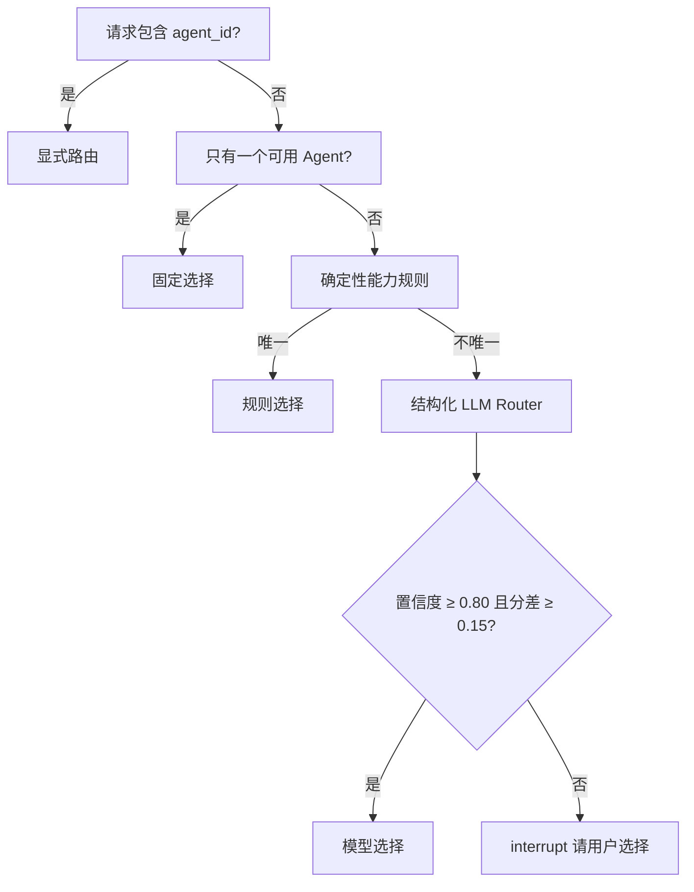

# 12 - 电商问数：Agent Router 与低置信度选择

---

**本章目标：**

- 掌握显式、规则、模型和人工四种路由模式。
- 理解置信度、候选分差和人工暂停策略。
- 防止模型选择未注册或越权 Agent。

**对应源码：** `app/harness/router.py`、`app/harness/graph.py`、`prompts/agent_router.prompt`

---

## 1、路由顺序



阈值来自 `Settings`，不散落在节点中。

## 2、显式路由

请求可以指定：

```json
{"query": "GMV 的统计口径是什么？", "agent_id": "catalog_qa"}
```

API 先检查 Agent 是否已注册、是否启用、是否对用户可见，再创建运行。

显式选择不会调用 Router LLM。

## 3、规则路由

当前规则主要识别：

- 明确取数意图：统计、排行、趋势、GMV 是多少。
- 明确目录定义：表结构、字段含义、指标口径。

规则是低成本快速路径，但必须避免把“GMV 的统计口径是什么”误判为真实取数。

## 4、模型路由

模型输入：

- 当前问题
- 最近对话
- 可用 Agent 的公共能力描述

输出必须符合 `RouterModelOutput`：

```json
{
  "agent_id": "catalog_qa",
  "confidence": 0.92,
  "alternatives": [],
  "reason_code": "catalog_definition",
  "resolved_query": "GMV 的统计口径是什么"
}
```

模型输出再经过：

- Pydantic 校验。
- 注册表 ID 校验。
- 用户权限校验。
- 候选阈值判断。

## 5、低置信度

低置信度不是直接回退问数 Agent。当前策略进入：

```python
interrupt({
    "kind": "agent_selection",
    "candidates": [...],
    "reason_code": "low_confidence",
})
```

Worker 创建 `agent_selection` 人工任务，用户选择后从 Checkpoint 恢复。

这属于 HITL，但与 SQL 审批是不同 kind，不要求四眼。

## 6、路由失败

以下情况进入人工选择：

- Router 超时或 JSON 非法。
- 模型选择未注册 Agent。
- 候选为空。
- 最高置信度或分差不足。

预算耗尽不会降级为人工选择，而是以 `BUDGET_EXCEEDED` 失败，避免绕过成本边界。

## 7、路由审计

运行保存：

```text
requested_agent_id
selected_agent_id
agent_version
route_mode
route_confidence
原因码
候选列表
Prompt 版本哈希
```

审计记录不保存完整用户问题。

## 8、路由评估

黄金集覆盖：

- 明确取数问题。
- 指标定义问题。
- “GMV 是多少”与“GMV 是什么”的易混对。
- 多轮追问。
- 低置信度。

```bash
uv run python -m evals.run_router_eval --threshold 0.8
```

实时评估需要真实模型配置；没有 LLM key 时脚本明确失败，不伪造结果。

## 9、注意事项

- Router 不能把任意模型字符串当作可执行入口。
- 不因路由失败重复调用直到成功，避免预算失控。
- 人工选择必须重新校验 Agent 仍处于启用状态。
- 不能把 Catalog 问题自动回退到 SQL Agent。
- 路由事件必须带稳定 reason code，便于统计低置信度率。

---

**本章小结：**

Agent Router 采用“显式优先、规则其次、模型兜底、人工确认”的顺序。每一步都受注册表、权限和预算约束，路由结果作为运行快照持久化。

[上一章：Agent 注册表](11-Agent注册表与运行契约.md) | [文档导航](README.md) | [下一章：Harness Graph 与双 Agent 子图](13-Harness%20Graph与双Agent子图.md)
