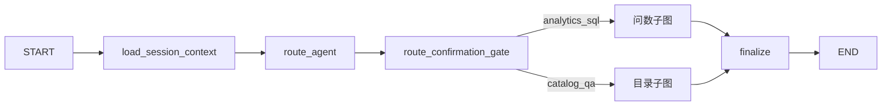

# 13 - 电商问数：Harness Graph 与双 Agent 子图

---

**本章目标：**

- 看懂外层 Harness Graph 的节点和边。
- 掌握 `analytics_sql` 与 `catalog_qa` 的隔离。
- 理解 Finalize 如何把子图输出映射为运行终态。

**对应源码：**

- `app/harness/graph.py`
- `app/agents/analytics_sql/graph.py`
- `app/agents/catalog_qa/graph.py`

---

## 1、外层图



外层 State 保存共享输入、路由、预算和 Agent 输出信封。子图内部节点读取各自业状态。

## 2、load_session_context

此节点：

- 启动有效执行计时。
- 初始化校正次数、审批次数和人工编辑标记。
- 记录本轮实际使用的会话窗口。

会话历史由 Worker 从 PostgreSQL/Redis 重建，不从旧请求对象继承。

## 3、route_agent

Router 完成后写回：

- `selected_agent_id`
- `agent_version`
- `route_mode`
- `route_confidence`
- `route_reason_code`
- `resolved_query`

有选择时同步更新 `runs` 并写审计；低置信度时只返回候选，交给确认节点。

## 4、route_confirmation_gate

如果 Router 已选择，节点直接通过。

否则调用 `interrupt()`，用户选择后：

1. 验证 Agent 仍在注册表和用户可用集合中。
2. 读取 Agent 版本和 Prompt 哈希。
3. 更新运行路由。
4. 写审计和 `agent.selected` 事件。
5. 恢复外层图。

## 5、analytics_sql 子图

```text
plan_query
  -> 三路召回（并行）
  -> merge_retrieved_info
  -> filter_table / filter_metric（并行）
  -> add_extra_context
  -> generate_sql
  -> validate_sql
  -> correct_sql（最多一次）
  -> validate_sql
  -> approval_gate
  -> run_sql
```

SQL 校正后必须重新校验，不会直接执行。

审批拒绝进入 `rejected` 节点；校验超过最大次数进入 `failed` 节点。

## 6、catalog_qa 子图

```text
load_catalog
  -> 字段/指标向量召回
  -> 按表补齐元数据
  -> answer_catalog
```

输出：

```json
{
  "answer": "GMV 表示所有订单成交金额总和。",
  "references": [
    {"type": "metric", "id": "GMV"}
  ],
  "confidence": 0.9,
  "limitations": []
}
```

引用必须来自本次召回目录。`catalog_qa` 不调用 SQL 执行工具，也不返回真实业务数据。

## 7、Finalize

外层 Finalize 根据：

- `approval_action=reject`
- Agent 输出 error code
- 正常完成

映射为 `completed`、`rejected` 或 `failed`。Worker 再负责写入终态、审计、事件和缓存失效。

## 8、节点可观测性

节点通过 `traced_node()` 包装：

- span 名称：`langgraph.node.<name>`
- 属性：Agent ID、Run ID
- Interrupt 被标记为 `langgraph.interrupted=true`，不误记为普通异常

## 9、隔离边界

| 内容 | analytics_sql | catalog_qa |
| --- | --- | --- |
| SQL Guard | 允许 | 禁止 |
| SQL 执行 | 允许 | 禁止 |
| 字段/指标召回 | 允许 | 允许 |
| 真实字段值 | 允许受控检索 | 不用于返回真实数据 |
| SQL 审批 | 允许 | 不需要 |

## 10、验证

```bash
uv run pytest tests/unit/test_harness_graph.py -q
uv run pytest tests/unit/test_tool_access.py -q
```

需要验证：

- 低置信度暂停后选择 Agent 可恢复。
- `catalog_qa` 无法调用 SQL 执行工具。
- 子图完成可被 Finalize 正确识别。
- Interrupt 不导致外层运行直接失败。

## 11、注意事项

- 外层图不持有子图内部状态的具体实现假设。
- 不把人工确认和 SQL 审批合并成同一动作。
- 不在节点中直接修改运行数据库状态，路由节点可按约定更新路由快照。
- 不把工具对象放入 Checkpoint。

---

**本章小结：**

Harness Graph 只负责跨 Agent 的共享控制流，两个 Agent 子图独立处理业务。路由确认、SQL 审批和终态映射都通过明确的状态与事件输出连接。

[上一章：Agent Router](12-Agent%20Router与低置信度选择.md) | [文档导航](README.md) | [下一章：多轮查询规划与并行召回](14-多轮查询规划与并行召回.md)
