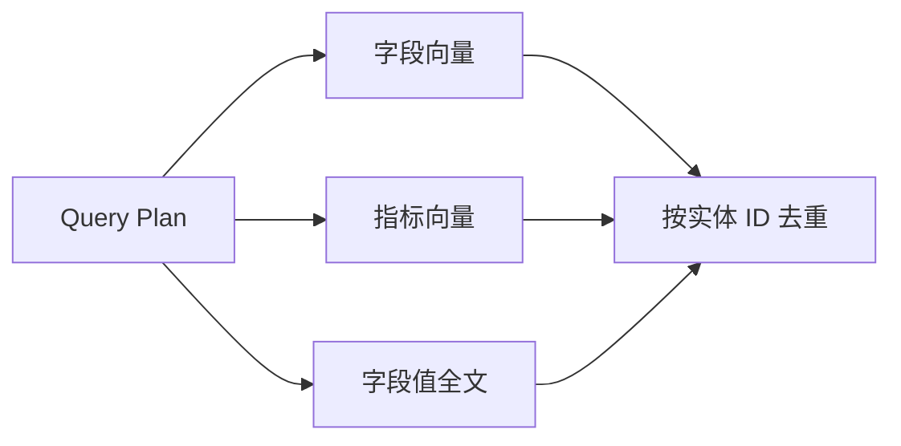

# 14 - 电商问数：多轮查询规划与并行召回

---

**本章目标：**

- 理解多轮追问如何变成独立查询。
- 掌握一次结构化 LLM 调用同时生成三路检索词。
- 理解有界并发、超时和召回去重。

**对应源码：** `app/agent/nodes/plan_query.py`、`recall_*.py`、`retrieval_utils.py`

---

## 1、为什么先规划

用户追问可能出现：

```text
先问：统计 2025 年第一季度各大区 GMV
再问：那 4 月呢？
```

第二句单独交给检索时缺少业务对象和时间范围。Query Planner 结合最近对话生成：

```json
{
  "resolved_query": "统计 2025 年 4 月各大区的 GMV",
  "column_terms": ["大区", "订单金额", "日期"],
  "metric_terms": ["GMV", "成交总额"],
  "value_terms": ["2025 年 4 月"]
}
```

## 2、历史窗口

Worker 从会话消息恢复最近对话：

- 默认最多 6 轮。
- 按字符预算保守限制，避免提示词无界增长。
- 不包含当前运行自己的用户消息重复项。

历史是 State 输入，不依赖浏览器本地状态。

## 3、一次调用生成三类检索词

旧实现为字段、指标、值各调用一次 LLM。当前 `plan_query` 使用一个结构化 Prompt 同时输出三类词，降低成本和延迟，并让多轮改写与三路检索共享同一语义。

输出经 `QueryPlanModel` 校验：

- `resolved_query` 非空。
- 三组检索词为列表。
- 去重并限制长度和数量。

## 4、Jieba 兜底

先使用 Jieba TF-IDF 提取确定性关键词，并始终保留完整问题。

如果 Query Planner 失败：

- 记录 fallback 原因。
- 使用原 query 和 Jieba 词作为三路兜底。
- 不伪造“规划成功”。

预算耗尽等 `AppError` 不进入兜底，直接终止，避免绕过成本控制。

## 5、三路召回



| 路径 | 输入词 | 存储 |
| --- | --- | --- |
| 字段 | column terms | Embedding + Qdrant |
| 指标 | metric terms | Embedding + Qdrant |
| 值 | value terms | Elasticsearch |

## 6、并发控制

每个召回节点内部使用：

- 分支级 `bounded_gather`。
- 全局工具 Semaphore。
- 单次调用 timeout。
- `TaskGroup` 保证一个失败会取消同组任务。

不是无界 `gather`，也不是每个关键词创建独立客户端。

## 7、去重

字段和指标按业务实体 ID 去重：

```text
ColumnInfo.id
MetricInfo.id
```

不能仅按 point id 去重，因为同一个字段有多个语义 point。

字段值按 `ValueInfo.id` 去重。

## 8、失败模式

- Planner JSON 非法：受控降级到词法召回。
- Qdrant 超时：该召回节点失败，不返回“空成功”。
- Embedding 失败：显式抛出。
- ES 索引缺失：检索失败。
- 并发超过上限：等待或按整体超时失败。

## 9、验证

```bash
uv run pytest tests/unit -q
```

重点看：

- `resolved_query` 是否保留业务对象和时间。
- 三路 terms 是否职责分离。
- 同一字段多个 point 是否在 state 中只出现一次。
- 处理词数是否受限。

## 10、注意事项

- 不把历史完整拼进系统 Prompt 而不限制大小。
- 不把字段、指标和值检索词混为一组。
- 不为所有关键词串行循环，否则高并发被放大。
- 不把模型生成的新表名、字段名写入目录。

---

**本章小结：**

查询规划用一次结构化模型调用完成多轮改写和三路检索词生成，召回节点使用有界并发和稳定实体去重。降级仅在明确记录的可恢复错误中发生，预算和安全错误仍直接失败。

[上一章：Harness Graph 与双 Agent 子图](13-Harness%20Graph与双Agent子图.md) | [文档导航](README.md) | [下一章：召回合并、过滤与 SQL 上下文](15-召回合并、过滤与SQL上下文.md)
