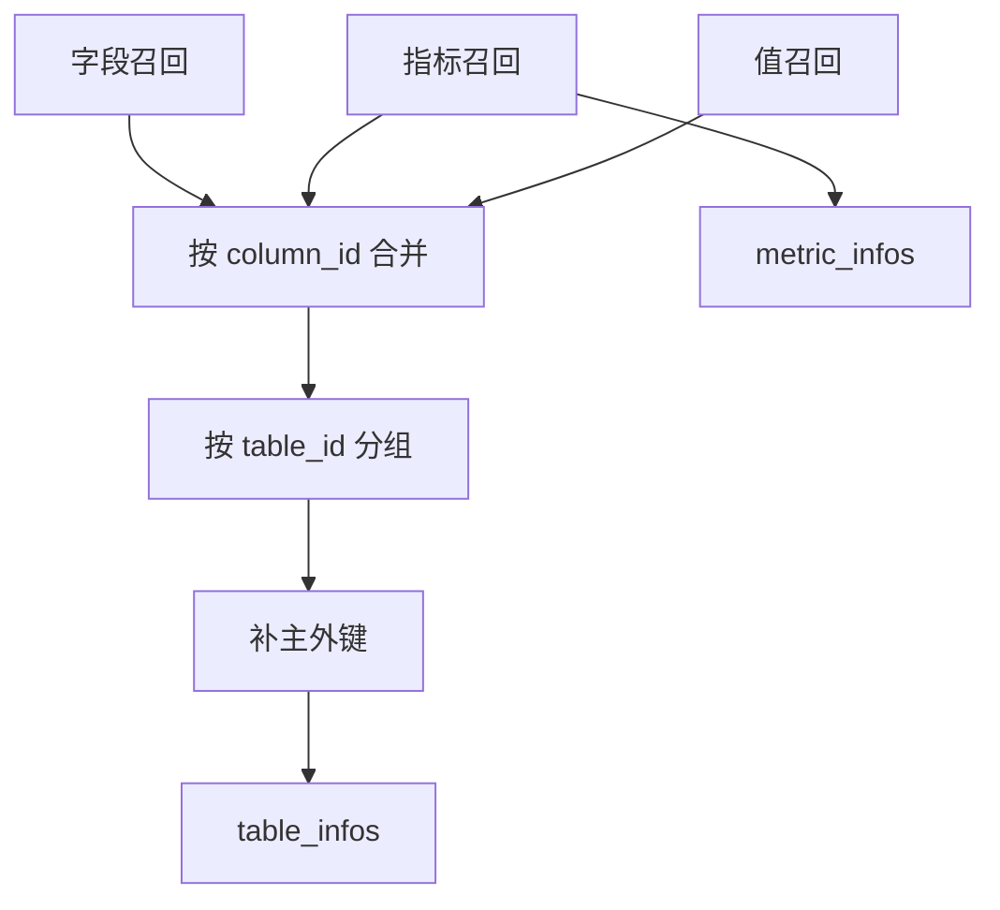

# 15 - 电商问数：召回合并、过滤与 SQL 上下文

---

**本章目标：**

- 将三类召回整合成表结构和指标上下文。
- 理解主外键补齐与字段值示例合并。
- 掌握 LLM 只做选择、程序负责裁剪的模式。

**对应源码：**

- `app/agent/nodes/merge_retrieved_info.py`
- `app/agent/nodes/filter_table.py`
- `app/agent/nodes/filter_metric.py`
- `app/agent/nodes/add_extra_context.py`

---

## 1、合并主线



召回阶段宁可多，合并阶段负责去重、补齐和组织。

## 2、指标依赖字段

指标匹配成功后，它的 `relevant_columns` 不一定在字段召回结果中。Merge 节点按字段 ID 从 Meta MySQL 补齐。

这样 `GMV` 不只是一个名称，还会带着 `fact_order.order_amount` 进入 SQL 上下文。

## 3、字段值示例

`ValueInfo` 包含：

- 字段 ID
- 用户问题命中的真实值

节点将该值补到对应字段 `examples`，帮助模型使用 `'华北'` 而不是 `'华北地区'`。

示例值只能作为上下文，不能当作 SQL 片段直接拼接。

## 4、主外键保障

用户不会主动问 `region_id`，但跨表查询必须使用它：

```sql
fact_order.region_id = dim_region.region_id
```

因此每张候选表都要从 Meta Repository 补齐主键和外键。后续表过滤仍保留这些字段。

## 5、表过滤

模型只返回选择结果：

```json
{
  "fact_order": ["order_amount", "region_id"],
  "dim_region": ["region_id", "region_name"]
}
```

程序根据结果从深层复制后的 `table_infos` 中裁剪。模型不重写完整 schema。

过滤后再次确保主外键仍在，防止模型漏选。

## 6、指标过滤

候选指标可能包含 `GMV` 和 `AOV`。模型按当前问题返回真正需要的名称数组，允许 `[]`。

指标必须来自候选集合，程序按名称保留原实体，因此描述、依赖字段和别名不会被模型改写。

## 7、额外上下文

`add_extra_context` 补齐：

- 业务时区下的当前日期。
- 星期与季度。
- DW 方言和版本。

这些信息用于相对时间和 SQL 方言推断，不属于元数据目录。

## 8、YAML 上下文

过滤节点用 YAML 向模型提供候选：

- `allow_unicode=True`
- `sort_keys=False`

YAML 更适合阅读嵌套表和字段，但进入提示词的上下文仍有大小边界。

示例文件：

[table_infos 示例](yaml/table_infos.yaml ":include :type=code")

[filtered_table_infos 示例](yaml/filtered_table_infos.yaml ":include :type=code")

## 9、失败模式

- 元数据字段不存在：明确失败，不落入无表上下文。
- 模型输出非对象/数组：解析失败进入上游失败处理。
- 过滤为空：后续 Guard 因目录为空拒绝执行。
- 主外键缺失：SQL Guard 阻止跨表越权查询。

## 10、验证

```bash
uv run pytest tests/unit -q
```

检查：

- 指标依赖字段是否补齐。
- 同一字段值是否去重。
- 表过滤是否不修改原 state 对象。
- 主外键是否在过滤后仍存在。
- 日期是否使用业务时区。

## 11、注意事项

- 模型只做语义选择，程序完成结构裁剪。
- 不把 JSON/YAML 字符串当业务实体继续传递。
- 不使用 `list.remove()` 边遍历边删除。
- 不把示例值当成 SQL 字面量。
- 不把数据库版本信息记录为敏感配置。

---

**本章小结：**

合并节点把三路召回整理成表与指标上下文，过滤节点再做语义精筛。主外键和真实值示例由确定性程序补强，LLM 只返回简单选择结果。

[上一章：多轮查询规划与并行召回](14-多轮查询规划与并行召回.md) | [文档导航](README.md) | [下一章：SQL 生成与安全校验](16-SQL生成、Guard、EXPLAIN与校正.md)
