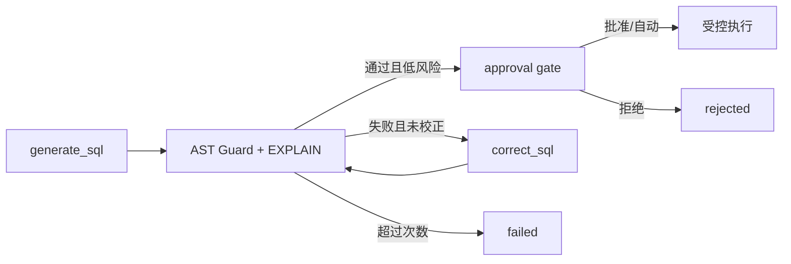

# 16 - 电商问数：SQL 生成、Guard、EXPLAIN 与校正

---

**本章目标：**

- 理解 SQL 生成前的完整上下文。
- 掌握 `sqlglot` AST 白名单和危险语法拦截。
- 理解只读事务、EXPLAIN、一次校正和结果封顶。

**对应源码：**

- `app/agent/nodes/generate_sql.py`
- `app/agent/nodes/validate_sql.py`
- `app/agent/nodes/correct_sql.py`
- `app/agent/nodes/run_sql.py`
- `app/tools/sql_guard.py`
- `app/tools/sql_execution.py`

---

## 1、生成前上下文

模型获得：

- resolved query
- 过滤后的表和字段
- 指标口径
- 日期/季度
- 数据库方言和版本

生成 Prompt 要求一条纯 SQL、真实表字段、只读查询和稳定列别名。

## 2、生成不等于执行

SQL 模型的输出是不可信输入。

## 3、AST Guard

`SQLGuard.inspect()` 执行：

1. MySQL 方言解析。
2. 只允许一个 SELECT/UNION/CTE。
3. 拒绝 DML、DDL、多语句和危险节点。
4. 拒绝文件函数、`SLEEP`、`FOR UPDATE`、`INTO`。
5. 校验表和字段在 resolved catalog 中。
6. 处理表别名和 CTE 名称。
7. 生成规范化 SQL 与 SHA-256。

只读限制不是正则表达式单点判断，而是 AST 结构检查。

## 4、目录白名单

允许表来自当前运行的 `table_infos`，允许字段来自其 columns 和受控 extra columns。

跨表主外键是在 merge/filter 阶段补齐的，若模型使用目录外表或字段，Guard 直接拒绝。

## 5、EXPLAIN 与风险

Guard 通过后执行只读 `EXPLAIN`：

- 设置数据库执行时限。
- 拒绝目录外 SQL。
- 解析语法、表名和字段名。
- 汇总估算扫描行。

风险原因包括：

- `corrected_sql`
- `sensitive_columns`
- `scan_estimate_exceeds_threshold`
- `high_scan_estimate`

敏感字段或超过高风险阈值需要异人审批；其他风险可普通审批。

## 6、一次校正

校验失败后最多进入一次 `correct_sql`：

- 保留原问题、SQL、错误和完整上下文。
- 要求最小修复，不改变业务语义。
- 校正后必须重新 Guard + EXPLAIN。
- 再次失败进入 failed。

禁止无界“生成-校正”循环。

## 7、审批哈希

审批载荷包含规范化 SQL 哈希。人工批准后如果 SQL 改变，Worker 或审批门会使旧决定失效。

审批通过的 SQL 必须仍是：

- 单条只读语句。
- 允许表字段。
- 当前预算内。

## 8、执行防护

`MySQLReadTool.execute()`：

- 再次解析且只接受 SELECT/UNION。
- 保留用户已有较小 LIMIT，超过系统上限则封顶。
- 设置 `MAX_EXECUTION_TIME`。
- 设置 session 为只读事务。
- Python `asyncio.timeout` 双重超时。
- 最多 1000 行和 2 MiB。
- Decimal 字符串化，日期 ISO-8601。
- 返回列、行、截断标记和耗时。

外连接 `LIMIT` 保留原始 ORDER BY，不使用可能丢失排序的派生表包装。

## 9、结果与审计

执行后：

- 结果写入运行 output。
- 只把摘要写入终态事件。
- 写 SQL 执行审计，含 SQL 哈希、行数、截断和耗时，不写完整敏感结果。

查询结果可在授权 GET Run 中读取。

## 10、失败模式

| 情况 | 结果 |
| --- | --- |
| 多语句/写操作 | SQL Policy Error，进入一次校正或失败 |
| `EXPLAIN` 报错 | 校正一次后再次校验 |
| 超时 | SQL timeout，不自动重试写操作 |
| 超行数 | 截断并标记 `truncated` |
| 审批哈希不匹配 | 409，不执行 |

## 11、注意事项

- 不用字符串黑名单替代 AST。
- 不接受模型提供的数据库连接或表名白名单。
- 不在审批前执行真实查询。
- 不复用读写账号作为唯一安全边界。
- 不记录完整 SQL 或结果到默认日志。

---

**本章小结：**

SQL 链路把模型能力限制在“生成候选”角色。Guard、目录白名单、EXPLAIN、审批哈希、只读事务、双重超时和结果封顶共同构成执行边界。

[上一章：召回合并与过滤](15-召回合并、过滤与SQL上下文.md) | [文档导航](README.md) | [下一章：Human-in-the-Loop](17-Human-in-the-Loop与四眼审批.md)
