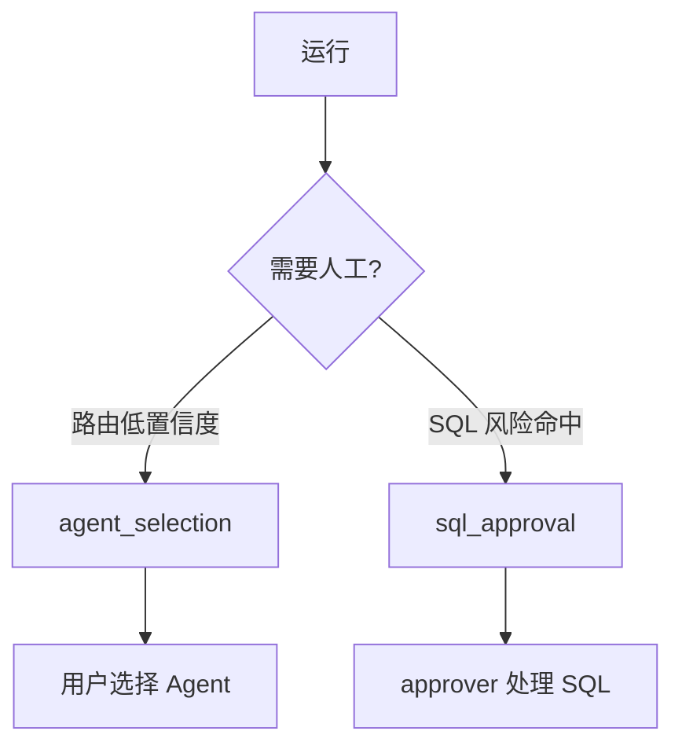
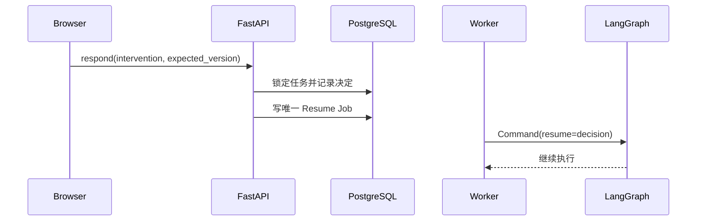

# 17 - 电商问数：Human-in-the-Loop 与四眼审批

---

**本章目标：**

- 理清 Agent 选择与 SQL 审批两类人工任务。
- 掌握批准、修改、拒绝、超时和四眼规则。
- 理解审批决定如何从 API 恢复到 LangGraph。

**对应源码：** `app/agent/nodes/approval_gate.py`、`app/harness/service.py`、`app/harness/store.py`、`frontend/src/components/InterventionCard.tsx`

---

## 1、两类人工任务



Agent 选择不需要 SQL 审批角色；SQL 审批必须具有 `agent:approver`。

## 2、SQL 何时暂停

以下任一条件：

- SQL 经模型或人工校正。
- 命中敏感字段。
- EXPLAIN 估算扫描超过 100k 行。
- 策略要求人工确认。

敏感字段或超过 1M 行估算属于高风险，发起人不能自己批准。

## 3、审批载荷

```json
{
  "kind": "sql_approval",
  "sql": "SELECT ...",
  "sql_hash": "...",
  "tables": ["fact_order"],
  "columns": ["fact_order.order_amount"],
  "estimated_rows": 120000,
  "risk_reasons": ["scan_estimate_exceeds_threshold"],
  "high_risk": false,
  "round": 1
}
```

审批只看这个不可变版本。新的 SQL 或新风险产生新任务。

## 4、三种动作

### 批准

检查任务版本、SQL 哈希、过期时间和角色。通过后创建唯一 Resume Job。

### 修改

审批人提交新 SQL。Worker 恢复图后重新执行 Guard、白名单、EXPLAIN、风险和预算检查。修改后仍按策略要求再次审批。

### 拒绝

必须提供原因。运行进入 rejected，不执行 SQL。

## 5、四眼

高风险 SQL：

- 审批人必须与发起人不同。
- 管理员也不能绕过。
- 审计同时保存发起人、审批人和 SQL 哈希。

普通审批允许有 `agent:approver` 角色的发起人处理。

## 6、状态与并发

人工任务具有：

- `version`
- `payload_hash`
- `status`
- `expires_at`

两个审批页面同时提交时，乐观版本和行锁只允许一个决定成功。重复提交同一决定按幂等处理。

## 7、超时与取消

- 默认人工等待 24 小时。
- 超时运行变为 expired。
- 取消运行会取消待处理任务。
- 人工等待不占 Worker 执行槽，也不计入 180 秒有效运行时间。

## 8、恢复流程



Worker 如果发现 checkpoint 已经没有 interrupt，则继续执行而未消费的节点，不重复响应。

## 9、前端行为

- 自动路由低置信度显示 Agent 卡片。
- SQL 审批显示 SQL、风险、扫描估算和轮次。
- 拒绝必须填写意见。
- 审批通过后保持原 SSE 连接；断线后按事件序号恢复。
- 刷新会话会重新加载 pending intervention。

## 10、审计与保留

审计记录：

- 任务 kind
- 运行 ID
- 决定
- 审批人
- 时间
- SQL 哈希和风险原因

默认保留 180 天；30 天后 SQL 正文和任务 payload 被脱敏。

## 11、注意事项

- 不把等待人工的 Worker 保持阻塞。
- 不用前端版本号替代后端版本校验。
- 不允许修改后跳过重新校验。
- 不允许高风险自批。
- 不把审批决定只放 Redis。

---

**本章小结：**

HITL 是一个持久化状态机，不是前端弹窗。LangGraph 中断点、人工任务、审批决定和 Resume Job 必须由 PostgreSQL 串起来，Redis 和 SSE 只负责低延迟通知。

[上一章：SQL 生成与安全校验](16-SQL生成、Guard、EXPLAIN与校正.md) | [文档导航](README.md) | [下一章：PostgreSQL 持久化与任务队列](18-PostgreSQL持久化、任务队列与Checkpointer.md)
