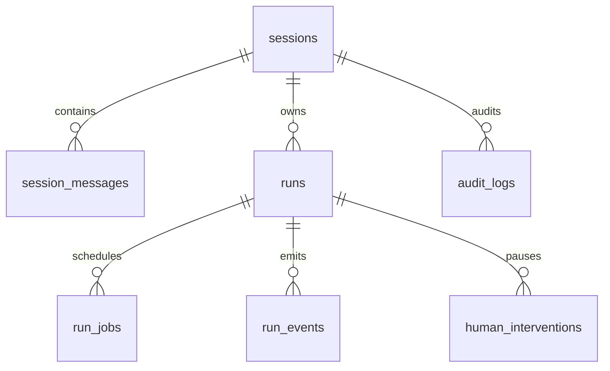

# 18 - 电商问数：PostgreSQL 持久化、任务队列与 Checkpointer

---

**本章目标：**

- 掌握 Harness 数据表和状态约束。
- 理解 PostgreSQL 持久任务队列、租约和恢复。
- 理解迁移、Checkpoint schema 和数据保留。

**对应源码：**

- `app/harness/db_models.py`
- `app/harness/store.py`
- `app/harness/checkpoints.py`
- `migrations/`
- `app/scripts/migrate.py`

---

## 1、PostgreSQL 是唯一权威

PostgreSQL 保存：

- `sessions`
- `session_messages`
- `runs`
- `run_jobs`
- `run_events`
- `human_interventions`
- `audit_logs`
- LangGraph Checkpoint 表

Redis 中的状态全部可以重建。

## 2、核心表关系



## 3、Run 字段

关键字段：

- 请求和实际 Agent、版本、路由快照。
- 运行状态、trace ID、traceparent。
- budget JSON。
- output JSON。
- idempotency key。
- 乐观版本和时间。

同一租户和会话的幂等键唯一。幂等重放返回原 Run，不重复入队。

## 4、单活运行

PostgreSQL 部分唯一索引限制同一会话最多一个活动运行：

```sql
CREATE UNIQUE INDEX uq_runs_one_active_session
ON harness.runs(session_id)
WHERE status IN ('queued', 'running', 'waiting_human');
```

应用层仍先给出清晰 409 错误；数据库索引防止并发竞态绕过。

## 5、持久任务队列

`claim_next_job` 使用事务和：

```sql
FOR UPDATE SKIP LOCKED
```

Worker 领取时写入租约。多个 Worker 不会拿到同一个 queued job。

任务状态：

```text
queued -> leased -> completed
                 -> queued（可重试）
                 -> failed
```

过期 leased 任务会被其他 Worker 回收。最多尝试 3 次，避免无限重试。

## 6、租约与心跳

- Lease 60 秒。
- 心跳 20 秒。
- 心跳失败会取消当前执行任务。
- 进程退出前尽量释放租约。

LLM 调用和 SQL 执行都必须受 timeout 约束，否则任务会长期占用执行槽。

## 7、事件权威记录

每个 Run 有从 1 开始单调递增的 seq。Append 时锁定 Run 行，避免并发产生重复 seq。

SSE 重连可按 `after_seq` 或 `Last-Event-ID` 回放。

## 8、Checkpoint

`AsyncPostgresSaver` 连接使用 `search_path=langgraph,public`，`prepare_threshold=0`。

运行时只执行 Checkpoint 的读写；表创建放在迁移任务中。运行账号不应获得无界 DDL 权限。

## 9、人工任务原子写入

响应审批时在同一事务：

1. 锁定 Intervention 和 Run。
2. 校验版本、状态、过期和决定。
3. 更新 Intervention。
4. Run 从 waiting_human 转 queued。
5. 写入唯一 Resume Job。

任何一步失败都整体回滚。

## 10、迁移

```bash
uv run python -m app.scripts.migrate
```

`migrate.py` 先运行 Alembic，再创建 LangGraph 表。

生产 Compose 使用单独 `migrate` 服务，并通过 `POSTGRES_MIGRATION_DSN` 提供 DDL 权限；API/Worker 使用 `POSTGRES_DSN`。

## 11、数据保留

| 数据 | 默认时间 |
| --- | --- |
| 会话正文、SQL、结果 | 30 天 |
| Run events | 7 天 |
| 人工任务与审计 | 180 天 |
| Checkpoint | 30 天 |

30 天时先删除/脱敏正文并删除 Checkpoint；180 天后硬删除最小运行与审批元数据。清理任务使用 advisory lock，多个 Worker 只执行一个批次。

## 12、验证

```bash
uv run pytest tests/unit/test_store_mapping.py -q
HARNESS_TEST_POSTGRES_DSN=postgresql://... uv run pytest tests/integration -q
uv run python -m app.scripts.migrate
```

重点：

- 幂等 Run 只创建一次。
- 两个 Worker 不会领取同一 Job。
- 租约过期可恢复。
- 审批并发只成功一次。
- SSE 事件 seq 无重复。

## 13、注意事项

- 不用 Redis 代替 Checkpoint。
- 不在 API 请求事务中执行长 Agent。
- 不使用无界重试。
- 不在运行时自动 drop/recreate schema。
- 不把生产迁移数据库账号提供给应用。

---

**本章小结：**

PostgreSQL 同时承担业务状态、持久任务队列、事件记录、人工任务和 LangGraph Checkpoint。明确的唯一约束、租约和事务边界让多 Worker 运行可以恢复且不重复。

[上一章：Human-in-the-Loop](17-Human-in-the-Loop与四眼审批.md) | [文档导航](README.md) | [下一章：Redis 热缓存与事件流](19-Redis热缓存、事件流与降级.md)
