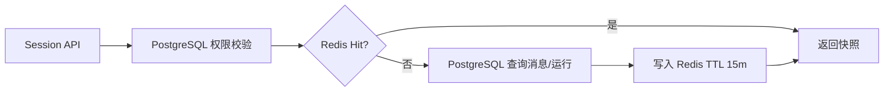

# 19 - 电商问数：Redis 热缓存、事件流与降级

---

**本章目标：**

- 理解 Redis 只作为可丢失热层的边界。
- 掌握会话快照、事件 Stream、限流和唤醒机制。
- 理解 Redis 故障时哪些请求降级、哪些入口拒绝。

**对应源码：** `app/harness/redis_runtime.py`、`app/harness/events.py`、`app/harness/service.py`

---

## 1、Redis 存什么

| Key 类型 | 内容 | TTL |
| --- | --- | --- |
| Session snapshot | 会话、消息摘要、近期运行 | 15 分钟 |
| Run events | 按 Run 的事件流 | 1 小时 |
| Rate key | 用户分钟限流 | 60 秒 |
| Wake list | Worker 有活通知 | 队列限长 |

会话 Key 包含 tenant，防止跨租户缓存键冲突。

## 2、Redis 不存什么

- 不保存权威 Checkpoint。
- 不保存唯一任务状态。
- 不保存不可重建审批事实。
- 不单独保存最终结果作为唯一副本。

## 3、会话快照

读取流程：



即使缓存命中，也先做 PostgreSQL 权限检查，避免同租户其他用户通过已知 session ID 读到缓存。

## 4、缓存失效

以下时机会主动失效：

- 创建 Run。
- 选择 Agent。
- 创建人工任务。
- 运行完成/失败/取消。
- 审批响应。

缓存写入发生在数据库提交后。Redis 失败只记录告警，不回写数据库。

## 5、事件流

节点事件先落 `run_events`，再 `XADD` 到：

```text
harness:run:{run_id}:events
```

Redis Stream 有 maxlen 和 TTL。SSE 可先读 Redis 以获得低延迟，再合并 PostgreSQL 历史记录，并按 seq 去重。

## 6、Redis 故障时的 SSE

`EventPublisher.replay()` 始终能回源 PostgreSQL。Redis 读取异常时返回空缓存，不阻断事件回放。

连接建立后发送 `retry: 3000`，每 15 秒心跳。

## 7、限流

用户分钟固定窗口由 Redis Lua 原子增加：

```text
INCR key
first request -> EXPIRE 60
count > limit  -> 429 + Retry-After
```

Redis 不可用时，新运行返回 503，因为无法严格执行分布式限流。已接受运行仍可通过 PostgreSQL 队列继续。

## 8、Worker 唤醒

API 入队后 LPUSH 一个唤醒信号。无任务时 Worker BRPOP 等待，并配置短轮询作为 Redis 不可用的兜底。

唤醒只是延迟优化，不能替代数据库任务表。

## 9、连接与超时

`Redis.from_url()` 配置：

- 最大连接数
- socket connect/read timeout
- health check interval
- decode responses

禁止在请求内创建新 Redis 客户端。

## 10、故障矩阵

| 故障 | API | Worker | SSE |
| --- | --- | --- | --- |
| Redis 读取失败 | 会话回源 PG | 正常轮询 PG | 回源 PG |
| Redis 写入失败 | 业务继续 | 业务继续 | 事件仍可回放 |
| Redis 完全不可用 | 新 Run 503 | 已接受任务继续 | PG 轮询 |
| Redis 数据被清空 | TTL 后重建 | 无影响 | 从 PG 补齐 |

## 11、验证

```bash
uv run pytest tests/unit/test_redis_runtime.py -q
```

覆盖：

- 快照 set/get。
- Event Stream round trip。
- TTL 和 key 隔离。
- Redis 异常时 PG 回退。

## 12、注意事项

- 不把 Redis 当主数据库。
- 不在缓存值中存 Secret 或 JWT。
- 不在缓存命中时跳过权限检查。
- 不用无界 Stream。
- 不把限流失败静默放行。

---

**本章小结：**

Redis 提供会话热读、实时事件、限流和唤醒等短路径能力，但所有关键事实仍由 PostgreSQL 决定。故障策略按数据可丢失性分别设计，避免缓存故障变成状态丢失。

[上一章：PostgreSQL 持久化与队列](18-PostgreSQL持久化、任务队列与Checkpointer.md) | [文档导航](README.md) | [下一章：FastAPI v1 API 与 SSE](20-FastAPI%20v1%20API、SSE与兼容层.md)
