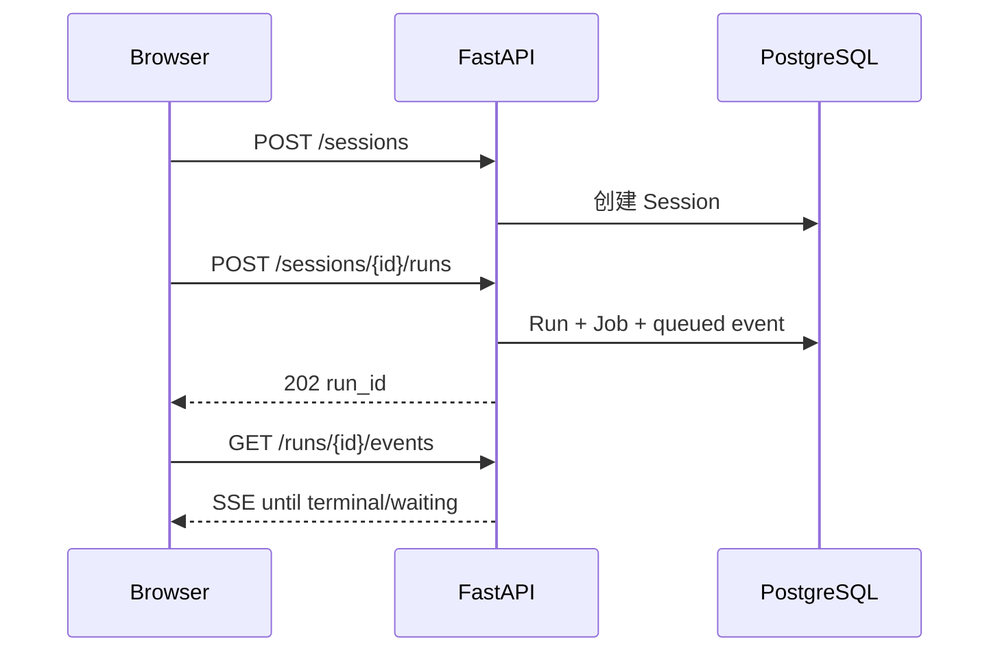

# 20 - 电商问数：FastAPI v1 API、SSE 与兼容层

---

**本章目标：**

- 掌握会话、运行和人工任务的 v1 API。
- 理解 SSE 命名事件、事件序号和断线续传。
- 理解旧 `/api/query` 仅作为弃用适配器。

**对应源码：** `app/api/app.py`、`app/api/routers/`、`app/api/schemas/v1.py`

---

## 1、API 流程



## 2、接口清单

| 方法 | 路径 | 说明 |
| --- | --- | --- |
| POST | `/api/v1/sessions` | 创建会话 |
| GET | `/api/v1/sessions` | 游标分页 |
| GET | `/api/v1/sessions/{id}` | 会话详情 |
| DELETE | `/api/v1/sessions/{id}` | 软删除并取消运行 |
| POST | `/api/v1/sessions/{id}/runs` | 创建运行，202 |
| GET | `/api/v1/runs/{id}` | 运行状态与结果 |
| GET | `/api/v1/runs/{id}/events` | SSE |
| POST | `/api/v1/runs/{id}/cancel` | 取消 |
| GET | `/api/v1/runs/{id}/interventions` | 人工任务 |
| POST | `/api/v1/interventions/{id}/respond` | 选择/批准/修改/拒绝 |
| GET | `/api/v1/agents` | Agent 列表 |

## 3、验证与错误

- OIDC JWT 通过 Bearer 传入。
- Query 1–4000 字符。
- `Idempotency-Key` 必须存在。
- 错误使用 `application/problem+json`。
- 409 表示版本、幂等、活动运行或 checkpoint 冲突。
- 429 表示限流，附带 `Retry-After`。
- 503 表示 Redis/依赖不可用或执行开关关闭。

## 4、SSE 格式

```text
id: 42
event: sql.approval_required
data: {"schema_version":"1.0","run_id":"...","seq":42,...}
```

事件类型包括：

- `run.queued`
- `run.started`
- `agent.selected`
- `node.progress`
- `agent.selection_required`
- `sql.approval_required`
- `run.completed`
- `run.failed`
- `run.rejected`
- `run.cancelled`
- `heartbeat`

## 5、断线续传

客户端可使用：

- `Last-Event-ID: 42`
- `?after_seq=42`

服务端返回更大 seq。Redis Stream 丢失后从 PostgreSQL `run_events` 回溯。

终态事件只包含输出摘要；完整结果通过 GET Run 读取，避免每次 Redis 事件都复制大表格。

## 6、旧 `/api/query`

兼容适配器：

- 自动创建会话和运行。
- 映射旧 `progress/result/error` SSE。
- 标记 OpenAPI deprecated。
- HITL 事件提示调用方迁移到 v1。

它不是新业务主入口。生产文档和前端应以 v1 为准。

## 7、应用装配

`create_app()` 注册：

- CORS
- TrustedHost
- Request ID / Content-Length middleware
- AppError、Validation、HTTP 和未知异常处理器
- v1 与 legacy router

FastAPI lifespan 只启动 API 侧资源，不启动 Worker。

## 8、幂等

相同 `Idempotency-Key`、会话和请求返回原 Run。如果请求体不同，返回 409。

重复请求不会重新发布 `run.queued`，但仍会做权限和限流检查。

## 9、取消与删除

- 取消写 cancelled、取消 jobs 和 pending interventions。
- 删除会话软删除并取消活动运行。
- Redis 会话缓存失效。
- Worker 发现终态后不再执行 SQL。

## 10、验证

```bash
uv run pytest tests/unit/test_api_contract.py -q
```

手动：

```bash
curl -X POST http://127.0.0.1:8000/api/v1/sessions \
  -H 'Content-Type: application/json' \
  -H 'Authorization: Bearer <jwt>' \
  -d '{"title":"测试"}'
```

创建 Run 后使用 curl/Apifox 打开 SSE。

## 11、注意事项

- SSE 连接不应直接执行 Agent。
- 不在流式响应开始后尝试改 HTTP 状态码。
- 不把完整 JWT 写入 URL。
- 不在前端长期保存服务端 Secret。
- 不把 API 端口绕过网关直接公开。

---

**本章小结：**

v1 API 把运行创建、状态查询、SSE 恢复和人工响应拆成独立资源。旧接口只保留短周期兼容，主流程以可重连、可审批的 `/api/v1` 为准。

[上一章：Redis 热缓存与事件流](19-Redis热缓存、事件流与降级.md) | [文档导航](README.md) | [下一章：应用装配与 Worker](21-应用装配、Worker与异步高并发.md)
