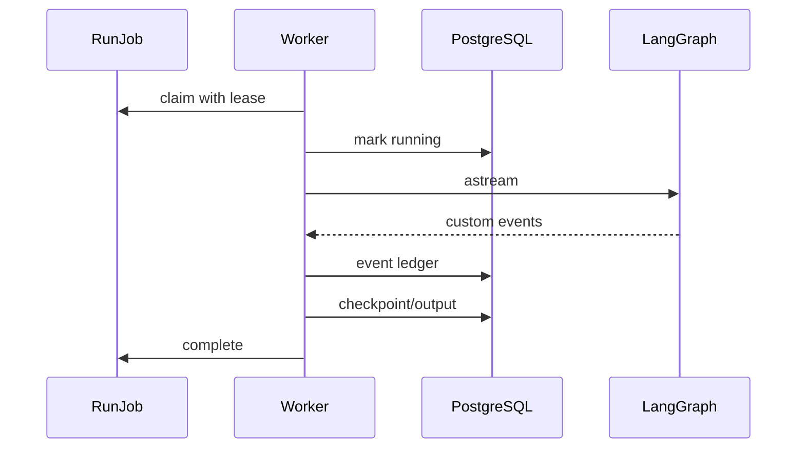

# 21 - 电商问数：应用装配、Worker 与异步高并发

---

**本章目标：**

- 理解 API 与 Worker 的进程职责。
- 掌握 ApplicationContainer 的启动、关闭和依赖装配。
- 理解 Worker 消费者、租约、心跳、预算和恢复控制。

**对应源码：** `app/application.py`、`app/api/lifespan.py`、`app/worker_main.py`、`app/harness/worker.py`

---

## 1、两个进程共用代码，不共用进程内状态

API：

- FastAPI + lifespan。
- PostgreSQL/Redis。
- JWT、RunService、SSE。

Worker：

- 持久队列消费。
- LangGraph 与 Checkpointer。
- MySQL/Qdrant/ES/LLM 客户端。
- OTel 和 Langfuse。

两者通过 PostgreSQL/Redis 协作，不共享 Python 对象。

## 2、ApplicationContainer

装配顺序：

```text
Settings
  -> Telemetry
  -> HarnessDatabase / Store
  -> Redis / EventPublisher
  -> AgentRegistry / Router
  -> JWT / RunService
  -> [Worker] clients + LLM + Checkpointer + Graph + Worker
```

API 不需要启动业务 LLM 和 Qdrant 客户端；Worker 不启动 HTTP 路由。

## 3、Lifespan

`@asynccontextmanager` 负责：

- 建立连接和客户端。
- 校验 PostgreSQL 和健康依赖。
- Worker 启动消费者。
- 应用关闭时停止 Worker、关闭客户端和数据库。

如果启动阶段发生异常，仍尝试释放已创建资源。

## 4、Worker 消费者

每个 Worker 进程默认有 32 个有界消费者。循环：

1. 从 PostgreSQL 领取 Job。
2. 没有 Job 时等待 Redis 唤醒/短轮询。
3. 处理 Job。
4. 启动心跳任务。
5. 执行 Graph 或记录失败。

消费者数、连接池和外部 API 并发必须分别限制。

## 5、处理一个 Job



人工中断时：

- 创建 Intervention。
- 保存预算。
- 完成任务租约。
- Worker 立即释放执行槽。

## 6、恢复输入

Worker 根据 Job 类型构造：

- Start：首次输入 Session 历史与 Run 元数据。
- Start 重试且已有 Checkpoint：传 `None` 继续。
- Resume：有 interrupt 时传 `Command(resume=...)`。
- Resume 重试且 interrupt 已消费：继续执行剩余 checkpoint。

这避免重复消费同一审批决定。

## 7、预算

每次运行：

- 最多 10 次 LLM。
- 64k tokens。
- 180 秒有效执行。
- 1 次 SQL 校正。

审批等待暂停有效计时。预算快照写入 Run，恢复时继续。

## 8、失败与重试

- 超时/可恢复依赖错误：Job 回队列。
- 业务校验错误：运行 failed，不无限重试。
- 超过最大 attempt：任务和运行失败。
- 版本不兼容：明确 `CHECKPOINT_AGENT_VERSION_INCOMPATIBLE`。

Worker 记录失败事件并失效会话缓存。

## 9、取消和优雅停机

- 用户取消后，Run 终态会阻止后续执行。
- Worker 停止接受新 Job。
- 在途任务优先完成或释放租约。
- 心跳丢失会取消当前协程。

## 10、并发验算

高并发不是一个无限 `asyncio.gather`：

- Worker 消费者数固定。
- LLM 全局 Semaphore。
- Qdrant/ES/Embedding 工具 Semaphore。
- MySQL 使用短 Session。
- 队列有最大深度。
- 用户/租户有活动运行配额。

## 11、验证

```bash
uv run pytest tests/unit/test_worker_completion.py -q
uv run pytest tests/unit/test_harness_graph.py -q
```

压测必须由独立测试环境执行：

```bash
uv run python scripts/load_test.py \
  --base-url https://agent-test.example \
  --connections 200 \
  --rate 20
```

## 12、注意事项

- API 容器不启动工作消费者。
- 不在 Worker 共享 request 对象。
- 不让等待审批占住连接。
- 不让 Redis 唤醒决定任务是否存在。
- 不使用无界 Task 或无限重试。

---

**本章小结：**

ApplicationContainer 统一装配依赖，API 和 Worker 以不同进程职责启动。Worker 通过租约、心跳、Checkpoint、预算和结构化重试，把 LangGraph 从本地执行器提升为持久运行器。

[上一章：FastAPI v1 API 与 SSE](20-FastAPI%20v1%20API、SSE与兼容层.md) | [文档导航](README.md) | [下一章：OIDC、RBAC 与 SQL 治理](22-OIDC、RBAC与SQL安全治理.md)
