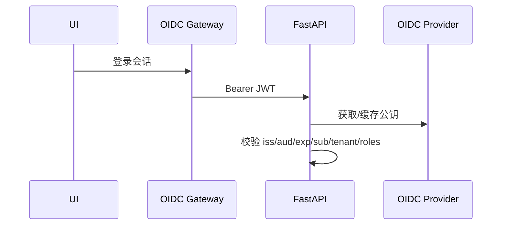
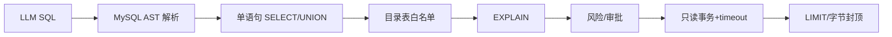

# 22 - 电商问数：OIDC、RBAC 与 SQL 安全治理

---

**本章目标：**

- 掌握 Gateway/OIDC JWT 的身份验证流程。
- 理解 user、approver、admin 角色权限。
- 形成 SQL 从生成到执行的纵深防御模型。

**对应源码：** `app/auth/oidc.py`、`app/tools/sql_guard.py`、`app/tools/sql_execution.py`

---

## 1、身份边界



FastAPI 不信任上游是否“看起来已登录”，而是重新验证签名和 claims。

## 2、JWT 校验

实现使用异步 JWKS 缓存：

- 只接受 RSA/EC 允许算法。
- 拒绝 `none`、未知 kid 和错误 issuer/audience。
- 检查 exp、iat、sub。
- 未知 kid 时允许一次强制刷新。
- JWKS 网络失败返回 503，不降级为匿名。

## 3、Claim 与角色

| Claim | 用途 |
| --- | --- |
| `sub` | 用户 ID |
| `tenant_id` | 租户隔离、配额和审计 |
| `roles` | `agent:user`、`agent:approver`、`agent:admin` |

权限：

- user：自己的会话和运行、显式 Agent 选择。
- approver：审批同租户 SQL。
- admin：查看注册/审计与运维信息，不绕过四眼。

## 4、生产与开发

生产缺少 issuer、audience、JWKS URL 时配置校验失败。`DEV_AUTH_ENABLED` 在 production/staging 被拒绝。

开发豁免只构造本地 Identity，不允许默认进入生产容器。

## 5、SQL 纵深防御



任何一层失败都不能继续执行。

## 6、AST 防护

拒绝：

- INSERT、UPDATE、DELETE、DDL。
- 多语句。
- SELECT INTO、FOR UPDATE。
- 文件读写、系统库和危险函数。
- 目录外表和字段。

表别名、CTE alias 需要正确解析，不能因别名绕过。

## 7、审批与哈希

高风险 SQL 必须异人审批。审批绑定规范 SQL 哈希；Worker 恢复时重新校验，不使用旧哈希执行新 SQL。

## 8、执行事务

- `MAX_EXECUTION_TIME`。
- Python timeout。
- session 只读事务。
- 最多 1000 行和 2 MiB。
- 查询包装保留排序。

当前复用现有 DW 账号是残余风险，生产优先提供只读 DSN。

## 9、Prompt Injection

用户文本与系统 Prompt、目录数据分离。Router 输出、SQL 和目录引用均经过 Schema/注册表/Guard 校验。模型不能创建一个新的工具或 Agent。

## 10、文件访问边界

- Prompt loader 只允许 `prompts/` 内相对名称。
- Meta 配置路径 resolve 后必须位于项目内。
- 不向用户暴露文件浏览工具。
- 拒绝路径穿越和符号链接逃逸。

## 11、验证

```bash
uv run pytest tests/unit/test_oidc.py -q
uv run pytest tests/unit/test_sql_guard.py -q
uv run pytest tests/unit/test_tool_access.py -q
```

覆盖：

- 有效/错误 audience JWT。
- 写操作、多语句、系统表、危险函数。
- Catalog 不能执行 SQL。
- 高风险自批被拒绝。

## 12、注意事项

- 不在日志打印 Authorization 或 JWT。
- 不使用纯正则作为唯一 SQL 安全机制。
- 不把管理员当作四眼审批绕过。
- 不把 Prompt 注入视为单纯措辞问题。
- 不把复用 MySQL 账号描述成完全只读。

---

**本章小结：**

身份、Agent 工具白名单和 SQL AST Guard 构成多层防御。OIDC 证明调用者是谁，RBAC 决定能做什么，Policy Engine 决定谁必须审批，SQL 执行工具最终保证只读、限时和限量。

[上一章：应用装配与 Worker](21-应用装配、Worker与异步高并发.md) | [文档导航](README.md) | [下一章：OpenTelemetry 与 Langfuse](23-OpenTelemetry、Langfuse与结构化日志.md)
