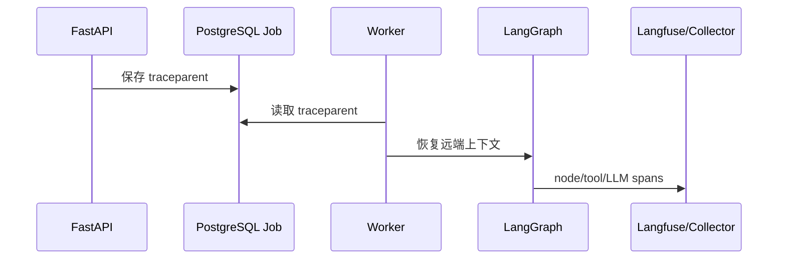

# 23 - 电商问数：OpenTelemetry、Langfuse 与结构化日志

---

**本章目标：**

- 理解 trace、metric、log 三类信号。
- 掌握 API → PostgreSQL Queue → Worker 的 trace 传播。
- 理解 Langfuse 观测与 PII 脱敏边界。

**对应源码：** `app/observability/telemetry.py`、`app/observability/nodes.py`、`app/core/log.py`、`docker/otel-collector-config.yaml`

---

## 1、观测目标

需要回答：

- 一次 HTTP 请求为何变慢？
- Run 在哪个节点失败？
- 队列等待多久？
- LLM 调用次数/token 是否超预算？
- SQL 执行多久、是否截断？
- Redis 是否回退到 PostgreSQL？

## 2、Trace 链路



`trace_id` 同时写入 Run 和事件；前端错误响应可返回 `X-Trace-ID`。

## 3、自动与手工仪器化

自动：

- FastAPI
- HTTPX
- SQLAlchemy
- Redis

手工：

- harness.run
- queue claim
- graph node
- LLM call
- approval/checkpoint/tool span

节点包装器 `traced_node()` 在 Interrupt 时设置 interrupted 属性，不把正常暂停标成错误。

## 4、Langfuse

Langfuse 使用独立 TracerProvider，但通过 trace context 关联 Harness trace。LangChain Callback 记录 model/prompt/generation/token。

默认不采集完整内容：

- query
- input/output
- SQL
- rows
- token/API key

需要内容调试时必须显式打开并确保脱敏。

## 5、Metric

关键指标：

- SSE 活跃连接
- Run started/finished/duration
- 队列领取
- LLM calls
- SQL duration
- 路由选择
- Cache hit/miss

`/metrics` 使用内网 Prometheus 格式，不通过公网 Nginx 公开。

## 6、采样

应用可配置 OTel sample ratio。生产 Collector 使用 tail sampling：

- 保留 ERROR。
- 保留超过 5 秒的慢 trace。
- 其他按比例采样。

Langfuse 外部实例自身可配置采样与保留。

## 7、结构化日志

Loguru 自定义 JSON sink 输出：

```json
{
  "level": "INFO",
  "message": "SQL executed",
  "request_id": "...",
  "run_id": "...",
  "trace_id": "..."
}
```

生产容器输出 stdout，不写文件目录。本地开发可选择文本格式和临时文件日志。

## 8、敏感数据

不记录：

- JWT/Authorization
- LLM key、数据库密码
- 完整 Prompt
- 完整查询结果
- 未脱敏 SQL 条件值

日志中允许的稳定关联：

- Run/Session/Agent ID
- 节点名
- 状态码
- SQL hash
- token/行数桶

## 9、故障降级

- OTel exporter 使用有限队列。
- Langfuse/Collector 不可用不阻塞 Run。
- 丢弃指标需要可见计数。
- PostgreSQL/Redis 业务失败与观测失败分开处理。

## 10、验证

```bash
uv run pytest tests/unit/test_budget_and_redaction.py -q
```

人工检查：

- 一个 Run 从 API 到 Worker 是否同一 trace。
- Langfuse 是否按 Agent/节点展示。
- 日志中是否无完整 SQL/JWT。
- `/metrics` 是否仅内网可访问。

## 11、注意事项

- 不用 trace ID 代替 Run ID。
- 不让观测调用改变业务结果。
- 不采集全部 Prompt 和结果。
- 不把 Langfuse Secret 放前端。
- 不给日志配置无限本地文件增长。

---

**本章小结：**

OpenTelemetry 提供统一 trace 和 metric，Langfuse 展示模型与 Agent 语义，结构化日志串联 request/run/trace。三者共同构成排障能力，但都必须默认脱敏和故障隔离。

[上一章：OIDC、RBAC 与 SQL 治理](22-OIDC、RBAC与SQL安全治理.md) | [文档导航](README.md) | [下一章：预算、限流、审计与保留](24-预算、限流、审计与数据保留.md)
