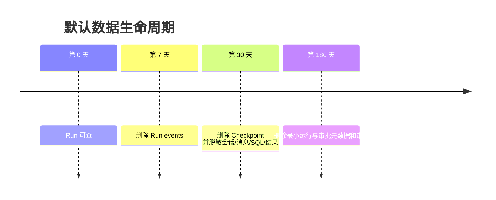

# 24 - 电商问数：预算、限流、审计与数据保留

---

**本章目标：**

- 掌握运行预算、活动配额和分钟限流的区别。
- 理解审计记录与 PII 脱敏。
- 掌握会话、事件、审批和 Checkpoint 的分级保留。

**对应源码：** `app/harness/types.py`、`app/harness/service.py`、`app/harness/store.py`、`app/conf/settings.py`

---

## 1、三层治理

| 层 | 控制什么 | 示例 |
| --- | --- | --- |
| Run Budget | 单次运行资源 | 10 次 LLM、64k tokens、180 秒 |
| Active Quota | 同时活动任务 | 每用户 5、每租户 50 |
| Rate Limit | 单位时间入口量 | 每用户每分钟 |

三者不能互相替代。

## 2、Run Budget

`RunBudget` 在每次 LLM 调用前检查：

- call count
- token total
- active seconds

LLM 返回后记录 usage。超预算抛出 `BUDGET_EXCEEDED`，不会重试到成功。

审批等待调用 `pause_clock()`，恢复时继续累计有效时间。

## 3、迭代边界

- 外层 LangGraph recursion limit 32。
- SQL 校正 1 次。
- 人工审批最多 2 轮。
- Job attempts 最多 3 次。
- Queue 有最大深度。

任何循环均有确定终止条件。

## 4、配额

创建 Run 时在事务中检查：

- 会话是否已有活动 Run。
- 用户活动 Run 数。
- 租户活动 Run 数。
- 队列待处理数。

数据库索引和行锁处理并发竞态。

## 5、Redis 限流

固定窗口 minute limit：

- 原子 INCR。
- 第一次请求设置 TTL。
- 超限返回 429。
- Redis 不可用时新 Run 503。

429 响应带 `Retry-After`。

## 6、审计

审计动作包括：

- Session 创建/删除。
- Run 创建/取消。
- Agent 路由。
- 人工任务响应。
- SQL 执行。

审计不保存完整问题、SQL 全文、结果或 Secret。SQL 执行审计保存哈希、行数、截断和耗时。

## 7、保留策略



30 天脱敏时会：

- 标题替换为过期标记。
- 消息正文替换。
- Run query/output/error/route 清空。
- Intervention payload/decision detail 清空。
- 会话不再出现在用户历史。

## 8、清理并发

清理任务使用 PostgreSQL advisory transaction lock。多个 Worker 同时运行维护循环时，只有一个执行当前批次。

Redis 缓存有独立短 TTL，不是长期数据副本。

## 9、隐私边界

- Langfuse 默认不采完整内容。
- 日志不采 JWT/Prompt/结果。
- ES 的字段值 `sync` 是数据治理开关。
- Qdrant payload 不塞完整业务记录。
- Session 删除先软删除，保留窗口后物理清理。

## 10、验证

```bash
uv run pytest tests/unit/test_budget_and_redaction.py -q
uv run pytest tests/unit/test_store_mapping.py -q
```

集成环境检查：

- 超用户/租户并发返回 429 或明确限额错误。
- 超时 LLM 不会无限重试。
- 保留任务能删除事件、Checkpoint 和过期会话。
- 审计记录在会话脱敏后仍可追踪。

## 11、注意事项

- 不把 token budget 只交给模型自行决定。
- 不用重试绕过预算。
- 不把 limit 写成散落在节点的 magic number。
- 不在日志或审计中保存 Secret。
- 不执行无边界删除；先用查询确定目标。

---

**本章小结：**

生产治理由单 Run 预算、活动配额、分钟限流和分级数据生命周期共同组成。所有限制集中在类型化配置中，失败返回稳定错误并保留审计证据。

[上一章：OpenTelemetry 与 Langfuse](23-OpenTelemetry、Langfuse与结构化日志.md) | [文档导航](README.md) | [下一章：前端 Agent 选择与审批交互](25-前端Agent选择、SSE与审批交互.md)
