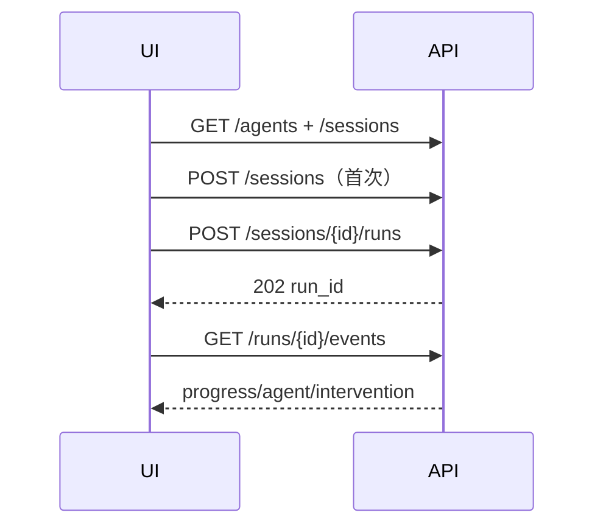

# 25 - 电商问数：前端 Agent 选择、SSE 与审批交互

---

**本章目标：**

- 掌握 React 如何创建 Session/Run 并消费 v1 SSE。
- 理解 Agent 自动/显式路由和人工选择。
- 理解审批卡、断线续传与历史恢复。

**对应源码：** `frontend/src/App.tsx`、`lib/agentApi.ts`、`components/InterventionCard.tsx`

---

## 1、前端数据模型

核心类型：

- `AgentInfo`
- `SessionSummary`
- `RunResponse`
- `RunEvent`
- `Intervention`
- `AgentOutput`
- `ChatMessage`

服务端返回的状态不能直接当 UI 文案，前端负责映射为步骤和卡片状态。

## 2、页面流程



每次提交生成新的 `Idempotency-Key`，网络重试使用同一键。

## 3、Agent 选择

界面提供：

- 自动路由
- 显式选择 `analytics_sql`
- 显式选择 `catalog_qa`

自动路由低置信度时，SSE 返回 `agent.selection_required`，页面展示候选卡片。选择后调用 Intervention API。

## 4、SSE 客户端

浏览器使用 fetch + ReadableStream，而不是 EventSource，以便携带同源认证和自定义 `Last-Event-ID`。

解析标准字段：

```text
id:
event:
data:

```

以空行分隔事件。非法 JSON 转成前端错误，不静默忽略。

## 5、断线续传

`streamRunEvents` 返回最新 seq。网络中断后前端最多按指数退避重试：

```text
after_seq = 最后已处理 seq
Last-Event-ID = after_seq
```

重连后服务端从 PostgreSQL/Redis 补齐事件，客户端按 seq 去重。

## 6、SQL 审批卡

显示：

- SQL
- 风险原因
- 扫描估算
- 是否高风险
- 审批轮次

动作：

- 批准
- 修改 SQL
- 拒绝

拒绝必须填写原因；版本过期返回 409，卡片显示可操作错误。

## 7、历史恢复

页面加载会话后：

- 加载消息和近 20 个运行摘要。
- waiting_human 运行额外加载 pending Intervention。
- 最近完成运行获取 output，恢复表格。

这样刷新页面不会丢失“等待审批”状态。

## 8、结果展示

- SQL 行集使用可滚动表格。
- `truncated` 明确提示截断。
- Catalog 回答显示 references。
- 错误显示 Problem Details 的用户可读信息，不展示堆栈。

React 默认转义文本，禁止 `dangerouslySetInnerHTML` 渲染模型输出。

## 9、并发与交互

- 同一会话只允许一个活动 Run。
- 等待审批或流式运行时禁用新问题提交。
- 新会话可绕开当前历史，但服务端继续按用户/租户配额控制。
- 取消会调用 API 后关闭本地流。

## 10、前端配置

```dotenv
VITE_API_BASE_URL=
VITE_DEV_PROXY_TARGET=http://127.0.0.1:8000
```

生产同域部署，Nginx 将 `/api` 转发至 FastAPI。OIDC 登录和 Bearer 注入由上游 Gateway 负责。

## 11、测试

```bash
pnpm --dir frontend lint
pnpm --dir frontend test
pnpm --dir frontend build
```

`InterventionCard.test.tsx` 覆盖：

- Agent 选择。
- 未填写原因不能拒绝。
- 修改 SQL 后提交。

## 12、注意事项

- 不把长期 JWT 或 Langfuse Secret 编译进 Vite。
- 不在断线时立即丢弃 run_id 和 seq。
- 不用本地文本猜测服务端状态。
- 不渲染未转义模型输出。
- 不在 SSE 已运行时重复创建同一 Run。

---

**本章小结：**

前端围绕 Session、Run 和 Intervention 三个资源建模，SSE 通过 seq 支持恢复，审批卡直接连接后端人工状态机。页面刷新后仍能从服务端恢复等待任务和最近结果。

[上一章：预算、限流与保留](24-预算、限流、审计与数据保留.md) | [文档导航](README.md) | [下一章：测试、评估与压力验证](26-测试、路由评估与压力验证.md)
