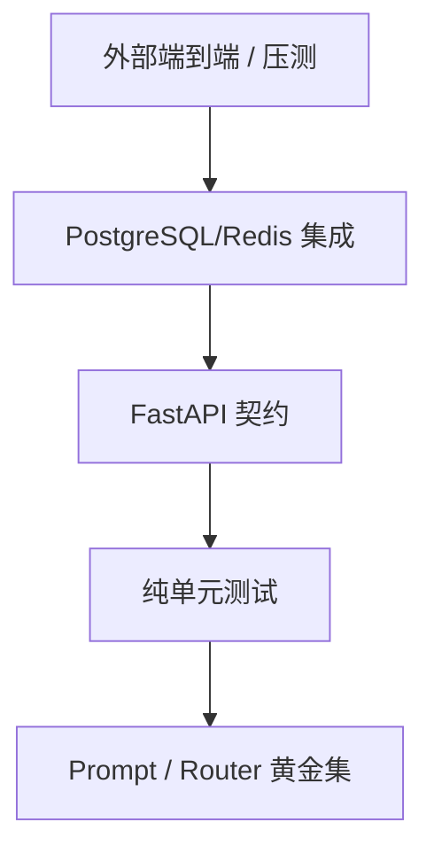

# 26 - 电商问数：测试、路由评估与压力验证

---

**本章目标：**

- 掌握单元、集成、契约、前端和评估测试边界。
- 理解哪些验证不能由单元测试替代。
- 建立 200 SSE、20 runs/s 的压测方法。

**对应目录：** `tests/`、`evals/`、`scripts/load_test.py`

---

## 1、测试金字塔



单元测试不能依赖真实模型或外部 API。集成测试需要显式 DSN。

## 2、单元测试

当前覆盖：

- SQL Guard 合法/非法 SQL。
- OIDC 有效和错误 audience。
- Agent 注册表和生产配置。
- Router 规则与低置信度。
- LangGraph Interrupt/Resume。
- Agent 路由选择。
- Redis 快照与事件。
- 高风险 SQL 四眼。
- Worker 完成路径。
- 日志/观测脱敏。
- 源码逐行注释覆盖。

命令：

```bash
uv run pytest tests/unit -q
```

## 3、API 契约

使用 `httpx.ASGITransport`：

- 测试 dev Identity。
- 测试 Agent 列表。
- 测试非法 Query Problem Details。
- 测试超大 Content-Length。

测试不要启动真实 lifespan 或连接生产服务。

## 4、PostgreSQL 集成

```bash
HARNESS_TEST_POSTGRES_DSN=postgresql://... \
  uv run pytest tests/integration -q
```

当前集成测试验证：

- 创建 Session。
- 幂等创建 Run。
- Run Job 入队。
- 事件 seq。

测试数据库必须是专用环境。未配置 DSN 时测试明确 skip，不能把它描述为已通过。

## 5、工具正向与失败用例

每个工具至少：

- 正常输入。
- 非法参数。
- 超时/依赖失败。
- 权限或目录越界。

SQL Guard 用例必须覆盖：

- SELECT/CTE/UNION。
- DML/DDL。
- 多语句。
- 系统表。
- 文件函数。
- 行锁。
- 目录外字段。

## 6、Router 黄金集

`evals/router_cases.json` 包含明确取数、目录定义、易混和低置信度问题。

实时评估：

```bash
uv run python -m evals.run_router_eval --threshold 0.8
```

没有 `LLM_API_KEY` 时脚本失败，这是预期行为，不应伪造准确率。

## 7、Prompt 评估

Prompt 或模型参数修改后至少评估：

- 路由准确率。
- 检索召回率。
- SQL 可执行率。
- SQL 结果正确率。
- 敏感 SQL 审批命中率。
- 成本和延迟。

评估集不能只包含教学样例，还应包含歧义、空结果、无权限和失败边界。

## 8、前端测试

```bash
pnpm --dir frontend lint
pnpm --dir frontend test
pnpm --dir frontend build
```

重点：

- Agent 选择卡。
- SQL 修改/拒绝。
- SSE 序号。
- pending intervention 恢复。
- 取消与错误。

## 9、压力验证

目标：

- 200 个持续 SSE。
- 20 次新 Run/秒成功入队。
- 多 Worker 混合流量。
- Redis 故障回退。
- Worker 重启和审批恢复。

脚本：

```bash
uv run python scripts/load_test.py \
  --base-url https://agent-test.example \
  --connections 200 \
  --rate 20
```

该脚本会产生真实模型和数仓调用，只允许在测试环境运行。

## 10、验收记录

每次发布记录：

- 实际命令。
- 通过/失败/跳过数量。
- 未验证原因。
- 性能 p50/p95。
- 是否修改 Prompt/模型与对应评估。

不能只写“已完成”，必须附证据。

## 11、注意事项

- 不为通过测试放宽断言。
- 不删除失败测试。
- 不用真实模型写单元测试。
- 不用 Redis mock 替代 PostgreSQL 一致性测试。
- 不把本地无 Docker 环境下的 Compose 测试标为通过。

---

**本章小结：**

单元测试保证规则和状态机，集成测试验证 PostgreSQL/Redis 语义，评估集验证提示词和路由质量，压测验证部署容量。不同层级必须分别报告，不能用一类结果替代另一类。

[上一章：前端 Agent 与审批交互](25-前端Agent选择、SSE与审批交互.md) | [文档导航](README.md) | [下一章：Docker Compose 生产部署与运维](27-Docker%20Compose生产部署与运维.md)
