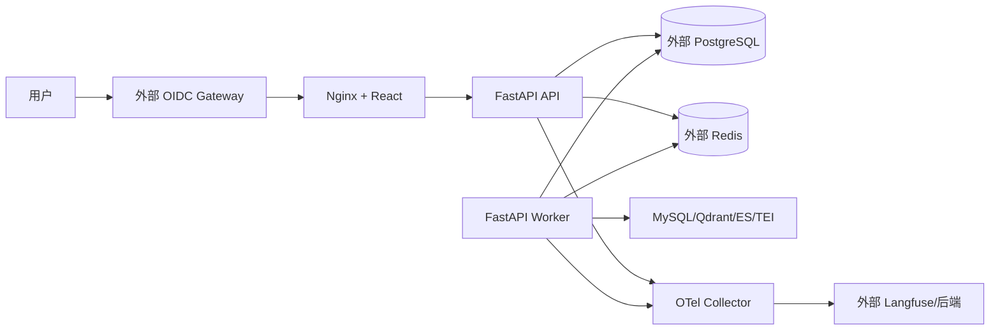

# 27 - 电商问数：Docker Compose 生产部署与运维

---

**本章目标：**

- 掌握 API、Worker、Web、OTel 和迁移服务拓扑。
- 理解外部 PostgreSQL/Redis/OIDC/Langfuse 的配置边界。
- 建立发布、回滚、备份、健康检查和故障处置流程。

**对应文件：**

- `Dockerfile`
- `docker/docker-compose.prod.yaml`
- `docker/otel-collector-config.yaml`
- `frontend/Dockerfile`
- `frontend/nginx.conf`

---

## 1、生产拓扑



API 端口不直接向公网暴露。浏览器通过同域 Nginx 访问 `/api`，身份由上游 Gateway 注入。

## 2、镜像

根 `Dockerfile` 使用多阶段构建：

- 固定 uv 构建依赖。
- Python 3.14 slim 运行时。
- 非 root 用户。
- 只读根文件系统。
- API、Worker 和 migrate 三个 target。

前端 Dockerfile：

- Node 构建 TypeScript。
- Nginx 提供静态资源。
- SSE 关闭 proxy buffering。
- 设置 CSP、frame、content-type 安全头。

## 3、一表迁移

生产 Compose 的 `migrate`：

1. 使用 `POSTGRES_MIGRATION_DSN`。
2. 执行 Alembic。
3. 创建 `langgraph` schema 和 Checkpoint 表。
4. 成功后 API/Worker 才启动。

运行账号只读业务表和 Checkpoint DML，不应拥有 schema DDL。

## 4、环境配置

关键变量：

```dotenv
APP_ENV=production
POSTGRES_DSN=...
POSTGRES_MIGRATION_DSN=...
REDIS_URL=rediss://...
OIDC_ISSUER=...
OIDC_AUDIENCE=...
OIDC_JWKS_URL=...
LANGFUSE_HOST=...
LANGFUSE_PUBLIC_KEY=...
LANGFUSE_SECRET_KEY=...
```

Secret 通过部署平台或 `.env` 注入，不写 Compose、镜像或仓库。

## 5、启动

```bash
docker compose -f docker/docker-compose.prod.yaml up --build -d
```

检查：

```bash
docker compose -f docker/docker-compose.prod.yaml ps
docker compose -f docker/docker-compose.prod.yaml logs --tail=200 api worker
```

## 6、健康检查

- `/health/live`：进程存活。
- `/health/ready`：关键依赖健康。
- API 启动要求 PostgreSQL；Redis 可降级。
- Worker healthcheck 检查 PG、Redis、MySQL、Qdrant、ES、TEI。

健康检查不输出凭据或内部堆栈。

## 7、Nginx 和 SSE

关键配置：

```nginx
proxy_buffering off;
proxy_cache off;
proxy_read_timeout 1h;
```

并发连接数、Nginx worker 和上游 API 副本要按压测结果配置。

## 8、发布步骤

1. 固化当前镜像 tag。
2. 备份 PostgreSQL 或确认 PITR。
3. 运行只增不减迁移。
4. 部署 Worker，确认可领取任务。
5. 滚动替换 API。
6. 执行 Agent/SSE/HITL 冒烟。
7. 观察错误率、队列和审批延迟。

Compose 不具备完整编排平台的滚动/自动回滚能力，部署脚本必须显式 drain 和健康检查。

## 9、回滚

- 先停止新流量。
- 切回上一个不可变镜像。
- 不立即回退已执行数据库迁移。
- 保持兼容 schema，按 expand/contract 移除旧字段。
- 对等待审批 Run 检查 Agent 版本兼容性。

## 10、备份和恢复

- PostgreSQL 是重点；Redis 不需要长期备份。
- 定期演练查询恢复、Checkpoint 表和审批数据。
- 恢复后先运行只读 smoke test。
- 不恢复未经脱敏的 Langfuse 内容到生产。

## 11、故障处理

| 故障 | 动作 |
| --- | --- |
| Redis 不可用 | 新 Run 503，旧 Run/SSE 走 PG |
| PostgreSQL 不可用 | readiness 失败，禁止新执行 |
| OIDC JWKS 不可用 | 新鉴权 503 |
| Langfuse 不可用 | 业务继续，保留 OTel 丢弃指标 |
| Worker 崩溃 | 租约到期后回收 |
| 队列积压 | 扩容 Worker，检查 LLM/数据库瓶颈 |

## 12、注意事项

- 不使用本地 Docker 数据库作为生产主存储。
- 不把 API 8000 端口直接暴露公网。
- 不使用 `latest` 镜像 tag。
- 不在日志中输出环境变量。
- 不在运行账户上授予 DDL。

---

**本章小结：**

生产 Compose 由 API、Worker、Web、OTel 和迁移任务组成，状态数据库和观测平台使用外部服务。发布重点是迁移权限分离、健康检查、SSE 代理和非破坏性回滚。

[上一章：测试、评估与压力验证](26-测试、路由评估与压力验证.md) | [文档导航](README.md) | [下一章：源码模块地图与扩展指南](28-源码模块地图、调试与扩展指南.md)
