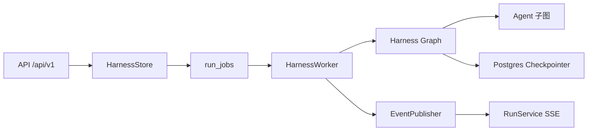

# 28 - 电商问数：源码模块地图、调试与扩展指南

---

**本章目标：**

- 根据现象快速定位 Harness 模块。
- 掌握 112 个 Python 模块的分组职责。
- 按安全契约扩展 Agent、工具、API 和观测。

**适用目录：** `app/`

---

## 1、调试入口

| 现象 | 首先查看 |
| --- | --- |
| API 401/403 | `app/auth/oidc.py` |
| Run 一直 queued | `app/harness/store.py` 队列、Worker 日志 |
| Worker 不领取 | Worker health、租约、Redis/DB |
| 路由错误 | `app/harness/router.py`、Router Prompt |
| 图暂停 | `app/harness/worker.py` interrupt 检测 |
| SQL 不执行 | `validate_sql`、SQL Guard、审批状态 |
| SSE 断线 | `run_events`、Redis Stream、after_seq |
| 前端无结果 | `agent.result`/终态 GET Run/前端 SSE 解析 |
| Langfuse 无 trace | OTel endpoint、Langfuse key、trace context |
| 数据保留异常 | `HarnessStore.purge_expired` |

## 2、agent 与 agents

`app/agent` 保存问数业务节点和共享 State/Context。

| 文件 | 职责 |
| --- | --- |
| `agent/__init__.py` | 兼容包声明 |
| `agent/context.py` | HarnessContext 兼容别名 |
| `agent/state.py` | 问数 Graph State 与子状态类型 |
| `agent/nodes/__init__.py` | 节点包 |
| `add_extra_context.py` | 日期、时区、DB 方言 |
| `approval_gate.py` | SQL approval interrupt |
| `correct_sql.py` | 一次最小 SQL 修复 |
| `filter_metric.py` | 指标选择 |
| `filter_table.py` | 表字段选择并保留主外键 |
| `generate_sql.py` | SQL 生成 |
| `merge_retrieved_info.py` | 召回合并上下文 |
| `plan_query.py` | 多轮规划与三路检索词 |
| `recall_column.py` | 字段向量召回 |
| `recall_metric.py` | 指标向量召回 |
| `recall_value.py` | 字段值全文召回 |
| `retrieval_utils.py` | 有界 TaskGroup |
| `run_sql.py` | 受控执行与执行审计 |
| `validate_sql.py` | AST Guard + EXPLAIN + 风险 |

`app/agents` 是 Agent 注册和子图封装。

| 文件 | 职责 |
| --- | --- |
| `agents/__init__.py` | 注册表包 |
| `agents/defaults.py` | 首版两个 Agent 注册 |
| `agents/types.py` | Definition、候选和路由 DTO |
| `agents/registry.py` | 启动校验与公共视图 |
| `analytics_sql/__init__.py` | 问数 Agent 包 |
| `analytics_sql/definition.py` | 静态定义 |
| `analytics_sql/graph.py` | SQL 子图 |
| `catalog_qa/__init__.py` | 目录 Agent 包 |
| `catalog_qa/definition.py` | 静态定义 |
| `catalog_qa/graph.py` | 目录检索和回答子图 |

## 3、API 与 Auth

| 文件 | 职责 |
| --- | --- |
| `api/__init__.py` | API 包 |
| `api/app.py` | FastAPI factory、中间件、错误处理 |
| `api/dependencies_v1.py` | v1 服务和容器依赖 |
| `api/lifespan.py` | API 生命周期 |
| `api/routers/__init__.py` | 路由包 |
| `agents_router.py` | Agent 查询 |
| `health_router.py` | liveness/readiness/metrics |
| `interventions_router.py` | 人工响应 |
| `query_router.py` | 旧 `/api/query` 适配 |
| `runs_router.py` | Run、取消、SSE |
| `sessions_router.py` | Session 生命周期 |
| `api/schemas/__init__.py` | Schema 包 |
| `query_schema.py` | 旧请求契约 |
| `v1.py` | v1 Public Schema 与 Problem Details |
| `auth/__init__.py` | 身份包 |
| `auth/oidc.py` | JWKS、JWT、角色依赖 |

## 4、Harness

| 文件 | 职责 |
| --- | --- |
| `harness/__init__.py` | 运行时包 |
| `checkpoints.py` | Postgres Checkpointer 生命周期 |
| `context.py` | 节点运行时 Context |
| `database.py` | SQLAlchemy Engine/Session |
| `db_models.py` | Harness ORM |
| `events.py` | 事件持久化、Redis 发布、SSE 编码 |
| `graph.py` | 外层 Harness Graph |
| `records.py` | 跨层数据记录 |
| `redis_runtime.py` | 缓存、Stream、限流、唤醒 |
| `router.py` | 显式/规则/LLM 路由 |
| `service.py` | Session、Run、Intervention 应用服务 |
| `store.py` | PostgreSQL 权威存储与队列 |
| `tool_access.py` | Agent 工具白名单执行 |
| `types.py` | Run/Job/Intervention/Event、Budget |
| `worker.py` | 消费者、租约、执行和恢复 |

`harness` 是跨 Agent 治理层。业务判断不应全部塞进 Store 或 Worker。

## 5、基础设施与数据层

| 分组 | 文件与职责 |
| --- | --- |
| Clients | `embedding_client_manager.py`、`es_client_manager.py`、`mysql_client_manager.py`、`qdrant_client_manager.py`：客户端生命周期 |
| Conf | `app_config.py`：业务基础设施 YAML；`meta_config.py`：目录配置；`settings.py`：环境与治理参数 |
| Core | `context.py`：ContextVar；`errors.py`：AppError；`log.py`：JSON 日志 |
| Infrastructure | `llm.py`：统一 ChatModel 和 Budget-aware 调用 |
| Prompt | `prompt_loader.py`：根目录约束和缓存 |
| Scoped | `repositories/scoped.py`：短 Session 代理 |

### Entities 与 Models

- `entities/column_info.py`、`column_metric.py`、`metric_info.py`、`table_info.py`、`value_info.py`
- `models/base.py`、`column_info.py`、`column_metric.py`、`metric_info.py`、`table_info.py`

Entities 面向业务，Models 面向数据库，两者不能混用。

### Repositories

| 文件 | 职责 |
| --- | --- |
| `repositories/__init__.py` | 仓储包 |
| `es/__init__.py` | ES 子包 |
| `es/value_es_repository.py` | 字段值索引/检索 |
| `mysql/__init__.py` | MySQL 子包 |
| `mysql/dw/__init__.py` | DW 子包 |
| `mysql/dw/dw_mysql_repository.py` | 安全标识符查询和 DB 信息 |
| `mysql/meta/__init__.py` | Meta 子包 |
| `mysql/meta/meta_mysql_repository.py` | 元数据读取/保存 |
| `mysql/meta/mappers/*.py` | 四个实体/ORM 转换器 |
| `qdrant/__init__.py` | Qdrant 子包 |
| `qdrant/column_qdrant_repository.py` | 字段向量 |
| `qdrant/metric_qdrant_repository.py` | 指标向量 |

## 6、Tools、Scripts 与服务

| 文件 | 职责 |
| --- | --- |
| `tools/__init__.py` | 工具包 |
| `tools/contracts.py` | SQL 输入 Schema |
| `sql_guard.py` | AST、白名单、风险 |
| `sql_execution.py` | EXPLAIN、只读执行、限流限行 |
| `scripts/build_meta_knowledge.py` | 知识库构建入口 |
| `scripts/migrate.py` | Alembic + Checkpoint migration |
| `services/meta_knowledge_service.py` | 元数据构建编排 |

## 7、可观测、健康与进程入口

| 文件 | 职责 |
| --- | --- |
| `observability/__init__.py` | 观测包 |
| `observability/nodes.py` | LangGraph Node span |
| `observability/telemetry.py` | Tracer/Meter/Collector/Langfuse |
| `application.py` | API/Worker 组合根 |
| `healthcheck.py` | Worker 容器 healthcheck |
| `worker_main.py` | Worker signal 与启动 |

## 8、状态流定位

调试时先确认对象在哪一层：

- HTTP 契约问题：API。
- 状态转换/权限/幂等：Store + Service。
- 长任务和重试：Worker + Job。
- Agent 业务：子图和 node。
- SQL 安全：Guard/Execution。
- 可见性：Event/Redis/SSE/Trace。

## 9、新增 Agent 检查表

1. 独立 Agent module 和定义。
2. 独立 State 与 Graph factory。
3. Prompt 文件受路径约束。
4. 工具白名单最小化。
5. 明确输入/输出 Schema。
6. 最大迭代、timeout、token 和成本预算。
7. 工具正向、失败、越权评估。
8. Router 能力和黄金集。
9. 静态注册与公共视图。
10. 更新源码地图和教程。

## 10、新增工具检查表

- 何时使用和不使用。
- Pydantic 参数校验。
- 超时和调用上限。
- 结构化错误，不静默返回空成功。
- 不接收任意 import path、shell 或未治理 SQL。
- OTel span 和审计。
- 正向、失败、边界用例。

## 11、注释与代码一致性

`tests/unit/test_app_source_comments.py` 要求 `app` 每个非空、非 docstring/多行字符串正文代码行都带注释。

修改代码时必须同步更新该行注释，不能留下描述旧行为的注释。

## 12、维护原则

- 优先扩展现有模块，不为未来假设创建空抽象。
- 只改任务直接相关范围。
- 生成资产、模型和数据库种子不自动重建。
- 修改 API、工具契约、模型、预算和超时前必须评估兼容与安全。
- 每次修改运行窄测试、单元测试、前端检查和相应评估。

---

**本章小结：**

按“请求入口 → 持久状态 → Worker → Graph → Agent → Tool → Observability”定位问题，可以避免把 API、数据库、Agent 业务和生产治理混成一层。新增能力必须同时更新契约、测试、评估和文档。

[上一章：Docker Compose 生产部署](27-Docker%20Compose生产部署与运维.md) | [文档导航](README.md)
